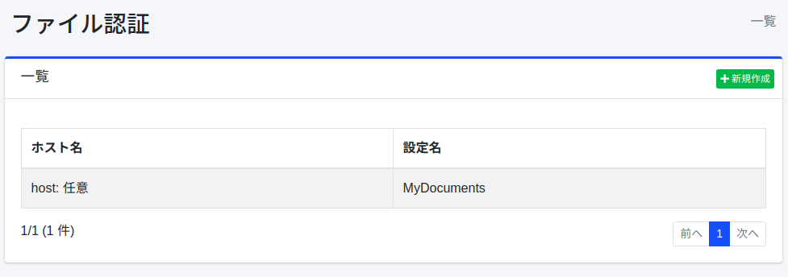
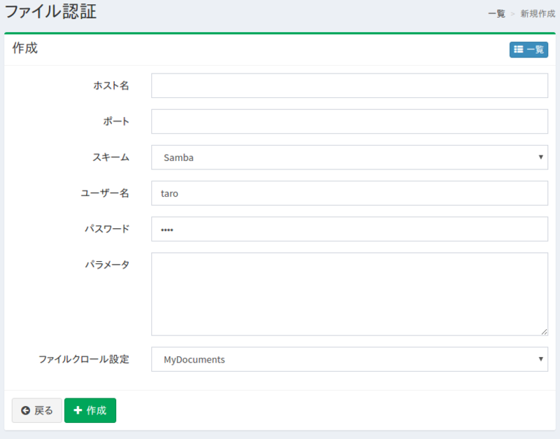

=========
ファイル認証
=========

概要
====

ここでは、ファイルを対象としたクロールに対してファイル認証が必要な場合の設定方法について説明します。 
|Fess| は FTP または Windows の共有フォルダーに対する認証に対応しています。

管理方法
======

表示方法
------

下図のファイル認証の設定を行うための一覧ページを開くには、左メニューの [クローラー > ファイル認証] をクリックします。

|image0|

編集するには設定名をクリックします。

設定の作成
--------

ファイル認証の設定ページを開くには新規作成ボタンをクリックします。

|image1|

設定項目
------

ホスト名
::::::

認証が必要なサイトのホスト名を指定します。
クロールするURLに書いたホスト名と同じ名前で指定してください。別の名前（たとえばIPアドレスと別名）で書いたURLには、この認証は使われません。

ポート
::::

認証が必要なサイトのポートを指定します。
空欄にすると、一覧には「任意」と表示されます。空欄の意味はスキームによって異なります。

* FTP: 任意のポートのURLに使われます（URLにポートがない場合は21番として扱われます）。
* SAMBA: ポートを書いていないURL（ ``smb://サーバー名/共有名/`` ）にだけ使われます。 ``smb://サーバー名:445/共有名/`` のようにポートを明示したURLには使われません。ポートを明示したURLをクロールする場合は、同じポートをここにも指定してください。

スキーム
::::::

認証方法を選択します。 
FTP または SAMBA (Windows共有フォルダー認証) を利用することができます。

ユーザー名
::::::::

認証サイトにログインするためのユーザー名を指定します。

パスワード
::::::::

認証サイトにログインするためのパスワードを指定します。

パラメーター
:::::::::

認証サイトにログインするために必要な設定値がある場合に設定します。SAMBA の場合、domainの値を設定することができます。設定する場合には以下のように記述します。

::

    domain=FUGA

ファイルクロール設定
:::::::::::::::

この認証設定を利用するクロール設定を指定します。

設定の削除
--------

一覧ページの設定名をクリックし、削除ボタンをクリックすると確認画面が表示されます。
削除ボタンを押すと設定が削除されます。

