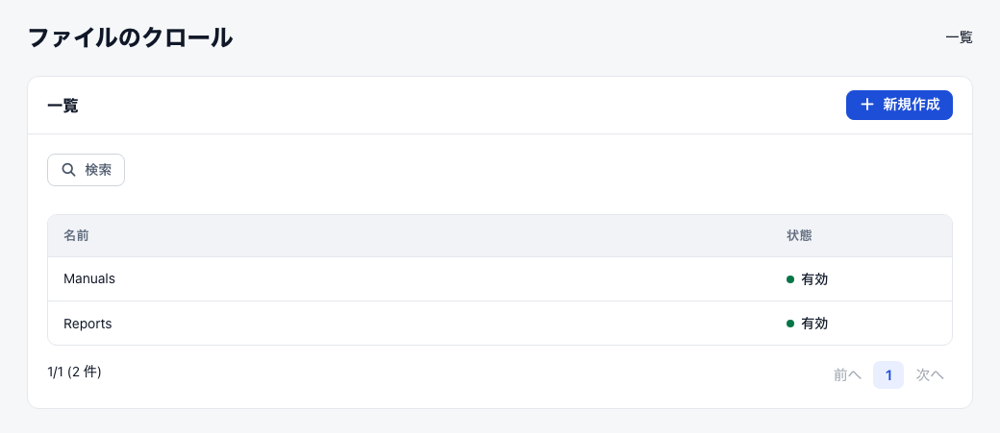
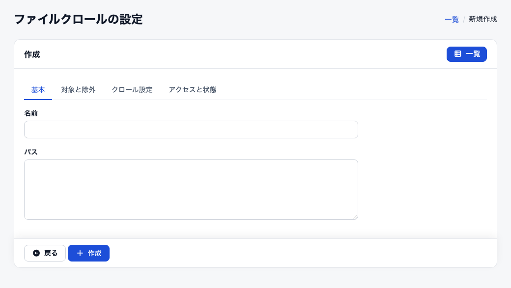
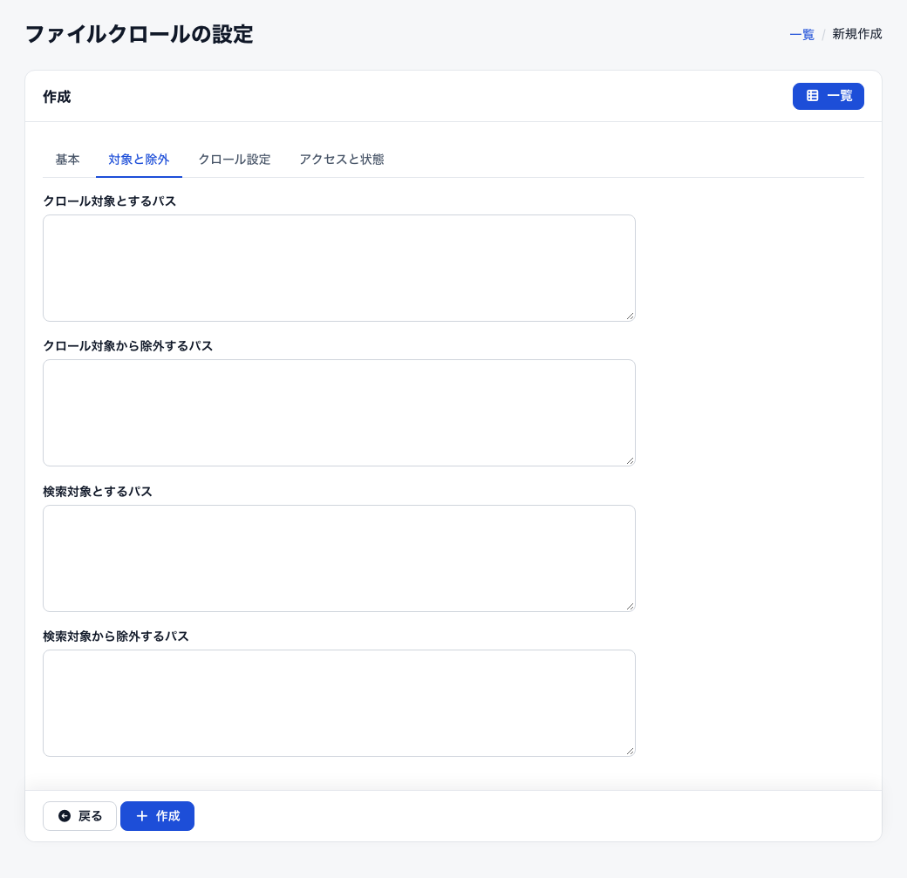
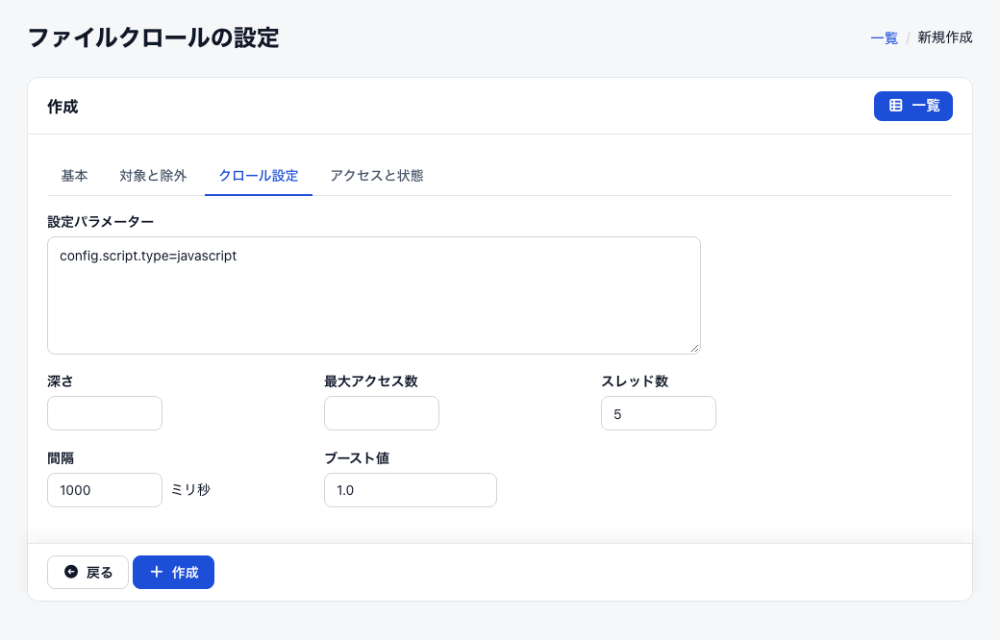
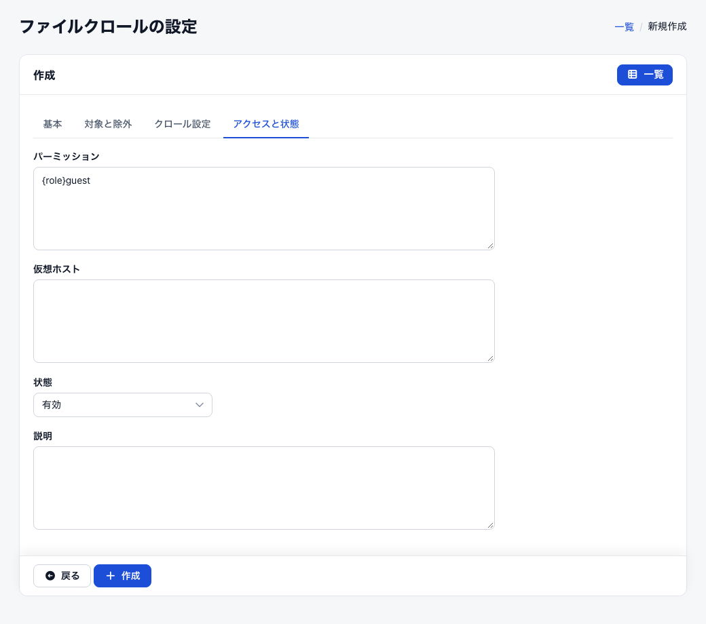

========================================
ファイルクロール（ファイルサーバー検索）
========================================

概要
====

ファイルクロールは、社内のファイルサーバーや Windows 共有フォルダー、クラウドストレージ上のドキュメントを |Fess| のインデックスに登録し、全文検索（ファイルサーバー検索）できるようにする機能です。Word・Excel・PowerPoint・PDF など多数のファイル形式に対応しています。

ファイルクロールの設定ページでは、ファイルシステム上や共有されているネットワーク上のフォルダーのファイルをクロールする設定を管理することができます。クロール対象は「パス」で指定するプロトコルによって決まります。

- ``file:/`` … ローカルまたはマウント済みのファイルシステム
- ``smb://`` … Windows ファイルサーバー／共有フォルダー（SMB/CIFS）
- ``smb1://`` … 旧来の SMB1 プロトコルを使用する Windows ファイルサーバー／共有フォルダー
- ``ftp://`` … FTP サーバー
- ``s3://`` … Amazon S3 バケット（ ``fess-storage-s3`` プラグインが必要）
- ``gcs://`` … Google Cloud Storage バケット（ ``fess-storage-gcs`` プラグインが必要）

管理方法
======

表示方法
------

下図のファイルクロール設定を行うための一覧ページを開くには、左メニューの [クローラー > ファイルシステム] をクリックします。

|image0|

編集するには設定名をクリックします。

設定の作成
-------

ファイルクロールの設定ページを開くには新規作成ボタンをクリックします。
ページは「基本」「対象と除外」「クロール設定」「アクセスと状態」の4つのタブに分かれています。タブ名をクリックすると表示が切り替わります。入力にエラーがある場合は、エラーを含むタブが自動的に開きます。各タブの項目を以下に説明します。

「基本」タブ
------------

|image1|

名前
::::

設定の名前です。

パス
::::

このパスでは、クロールを開始する場所を指定します（例: file:/, smb://, s3://, gcs://）。複数指定する場合は1行に1つ記述します。

「対象と除外」タブ
------------------

|image2|

クロール対象とするパス
:::::::::::::::::

この項目で指定した正規表現(Javaフォーマット)にマッチするパスは |Fess| クローラーの対象となります。

.. note::
   このパターンは、クロールが訪れるすべてのパス（開始パスやサブディレクトリを含む）に対して、パス全体との一致で適用されます。 ``.*\.(md|rst|adoc)$`` のように拡張子だけを指定すると、開始パスやサブディレクトリがパターンに一致せず、ファイルにたどり着けないため何もクロールされません。拡張子で絞り込むときは、同じパターンを「検索対象とするパス」に指定してください（ディレクトリはたどられ、一致したファイルだけが検索対象になります）。「クロール対象とするパス」には、開始パスやサブディレクトリにも一致するパターンを指定します。

クロール対象から除外するパス
:::::::::::::::::::::

この項目で指定した正規表現(Javaフォーマット)にマッチするパスは |Fess| クローラーの対象となりません。

検索対象とするパス
::::::::::::::

この項目で指定した正規表現(Javaフォーマット)にマッチするパスは検索の対象となります。

検索対象から除外するパス
::::::::::::::::::

この項目で指定した正規表現(Javaフォーマット)にマッチするパスは検索の対象となりません。

.. note::
   この指定が効くのは、以後のクロールで索引する文書です（一致した文書は索引されません）。すでに索引されている文書は、この指定を追加しても削除されず、検索結果に残ります。全般設定の「最終更新日時の確認」が有効（既定）で更新のない文書は、クロールのたびに有効期限が延長されるため（ :doc:`general-guide` の「最終更新日時の確認」を参照）、「以前のドキュメントを削除」の期限が来ても消えるとは限りません。検索結果から確実に消したい文書は、検索リスト（管理画面）で削除してください。削除した文書は、この指定に一致する間、次のクロールで再び索引されません。

「クロール設定」タブ
--------------------

|image3|

設定パラメーター
::::::::::::

クロール設定情報を指定することができます。

``file:`` で始まるパス（ローカルまたはマウント済みのファイルシステム）のクロールでは、シンボリックリンクをたどるかどうかを ``client.followSymlink`` で指定できます。デフォルトは ``true`` （たどる）です。 ``false`` を指定すると、シンボリックリンクは対象から外れ、リンク先のファイルはリンク経由ではクロールされません（スキップしたリンクは ``fess-crawler.log`` に INFO レベルで記録されます）。リンクをたどると、リンク先のファイルがリンクを含む設定のパーミッションでもう一度登録されるため、リンク先よりも多くのユーザーが読める共有をクロールする場合は ``false`` を検討してください。

::

    client.followSymlink=false

深さ
::::

クロールするファイルシステム構造の深さを指定します。

最大アクセス数
:::::::::::

インデックスするパスの数を指定します。

スレッド数
::::::::

この設定のために使用するスレッドの数を指定します。

間隔
::::

スレッドがパスをクロールするごとに待機する時間（ミリ秒）を指定します。

ブースト値
::::::::

ブースト値とは、この設定によってインデックスされたドキュメントの優先度です。

「アクセスと状態」タブ
----------------------

|image4|

パーミッション
:::::::::::

この設定のパーミッションを指定します。
パーミッションの指定方法は、たとえば、developerグループに属するユーザーに検索結果を表示させるためには{group}developerと指定します。
ユーザー単位の指定は{user}ユーザー名、ロール単位の指定は{role}ロール名、グループ単位の指定は{group}グループ名で指定します。
``(deny){role}ロール名`` のように ``(deny)`` を付けると、拒否の指定になります。 ``(allow)`` / ``(deny)`` の直後や、行頭に空白（全角空白を含みます）を置いて ``{user}`` ・ ``{group}`` ・ ``{role}`` を続けた記述、 ``(deny)`` や ``{role}`` などを全角文字で入力した記述、 ``(allow)`` / ``(deny)`` の直後や先頭に見えない文字（ゼロ幅スペースやバイトオーダーマークなど）がある記述は、15.10 では保存時にエラーになります。以前のバージョンで保存された値がこの形になっている場合は、入力し直してください。詳しくは :doc:`../config/security-role` を参照してください。

仮想ホスト
::::::::

仮想ホストのホスト名を指定します。複数指定する場合は1行に1つ記述します。
詳しくは :doc:`設定ガイドの仮想ホスト <../config/security-virtual-host>` を参照してください。

状態
::::

この設定が有効であるとき、デフォルトクローラーのジョブはこの設定を含んでクロールを行います。

説明
::::

説明を入力できます。

設定の削除
--------

一覧ページの設定名をクリックし、削除ボタンをクリックすると確認ダイアログが表示されます。削除ボタンを押すと設定が削除されます。

.. note::

   設定を削除しても、その設定がすでにインデックスに登録したドキュメントは削除されません。ドキュメントは有効期限が切れるまで検索できます。ドキュメントは、最後にそのドキュメントを登録・更新したクロールの開始時刻から、 :doc:`general-guide` の「以前のドキュメントを削除」（ ``day.for.cleanup`` 、デフォルトは ``3`` ）で指定した日数が経過すると有効期限が切れ、その後 Doc Purger ジョブがインデックスから削除します。 ``-1`` の場合、有効期限なしで登録されたドキュメントはこの方法では削除されません。

   ドキュメントをすぐに削除するには、自分でインデックスから削除してください。検索画面（ :doc:`searchlist-guide` ）で、その設定のドキュメントを検索し（たとえば ``url:`` や ``host:`` で絞り込み）、ヒットしたドキュメントを確認してから「このクエリですべてを削除」ボタンをクリックします。 ``DELETE /api/admin/searchlist/query`` でも同じことができます（ :doc:`../api/admin/api-admin-searchlist` を参照）。

   設定のアクセス権限を変更して再度クロールする場合は異なります。ドキュメントIDはアクセス権限によって決まり、クローラーはドキュメントを登録するときに、同じ設定が以前に登録した、同じURLで異なるIDのドキュメントを削除します。

例
==

ローカルファイルをクロール
--------------------

/home/share 下のファイルをクロールするならば、設定は以下のようになります。

.. tabularcolumns:: |p{4cm}|p{8cm}|
.. list-table::
   :header-rows: 1

   * - 名前
     - 値
   * - 名前
     - Share ディレクトリ
   * - パス
     - file:/home/share

他のパラメーターはデフォルトの設定で構いません。

Windowsの共有フォルダーをクロール
---------------------------

\\SERVER\SharedFolder 下のファイルをクロールするならば、設定は以下のようになります。

.. tabularcolumns:: |p{4cm}|p{8cm}|
.. list-table::
   :header-rows: 1

   * - 名前
     - 値
   * - 名前
     - 共有フォルダー
   * - パス
     - smb://SERVER/SharedFolder/

共有フォルダーのアクセスに ユーザー名/パスワード が必要ならば、左メニューの [クローラー > ファイル認証] からファイル認証の設定を作成する必要があります。
その際の設定は以下のようになります。

.. tabularcolumns:: |p{4cm}|p{8cm}|
.. list-table::
   :header-rows: 1

   * - 名前
     - 値
   * - ホスト名
     - SERVER
   * - スキーム
     - Samba
   * - ユーザー名
     - (入力してください)
   * - パスワード
     - (入力してください)

Amazon S3バケットをクロール
------------------------

my-bucket バケット下のファイルをクロールするならば、設定は以下のようになります。

.. tabularcolumns:: |p{4cm}|p{8cm}|
.. list-table::
   :header-rows: 1

   * - 名前
     - 値
   * - 名前
     - S3 バケット
   * - パス
     - s3://my-bucket/

S3へのアクセスには認証情報が必要です。「設定パラメーター」に以下を設定します。

::

    client.endpoint=https://s3.ap-northeast-1.amazonaws.com
    client.accessKey=YOUR_ACCESS_KEY
    client.secretKey=YOUR_SECRET_KEY
    client.region=ap-northeast-1

.. note::
   Amazon S3 と S3 互換ストレージへの対応は ``fess-storage-s3`` プラグインから提供されます。
   配布物には同梱されていないため、管理画面の「システム > プラグイン」ページ、または
   ``bin/fess-setup install plugin fess-storage-s3`` で導入してください。

Google Cloud Storageバケットをクロール
-----------------------------------

my-gcs-bucket バケット下のファイルをクロールするならば、設定は以下のようになります。

.. tabularcolumns:: |p{4cm}|p{8cm}|
.. list-table::
   :header-rows: 1

   * - 名前
     - 値
   * - 名前
     - GCS バケット
   * - パス
     - gcs://my-gcs-bucket/

GCSへのアクセスには認証情報が必要です。「設定パラメーター」に以下を設定します。

::

    client.projectId=your-project-id
    client.credentialsFile=/path/to/service-account.json

.. note::
   Google Cloud Storage への対応は ``fess-storage-gcs`` プラグインから提供されます。配布物には
   同梱されていないため、管理画面の「システム > プラグイン」ページ、または
   ``bin/fess-setup install plugin fess-storage-gcs`` で導入してください。

関連ページ
==========

- :doc:`../config/crawler-basic`
- :doc:`fileauth-guide`
- :doc:`../config/datastore/ds-overview`
- :doc:`../config/search-basic`
- :doc:`../user/index`

.. pdf            :height: 940 px
