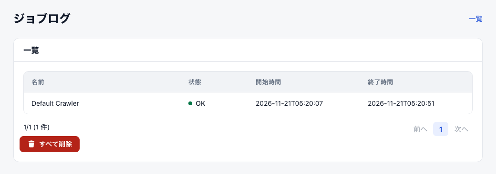

========
ジョブログ
========

概要
====

実行したジョブの結果を一覧として表示します。

管理方法
======

表示方法
------

下図のジョブログ確認ページを開くには、左メニューの [システム情報 > ジョブログ] をクリックします。

|image0|

一覧には、ジョブ名、状態、開始時間、終了時間が表示されます。
一覧の下のすべて削除ボタンをクリックすると、すべてのジョブログを削除します。確認ダイアログが表示されます。

ジョブログ詳細
-----------

ジョブのログ内容を確認できます。ジョブ名、ステータス、開始・完了時刻、結果などを表示します。

|image1|

名前
::::

実行されたジョブ名。

状態
::::

ジョブの実行結果。

.. note::
   クロールのジョブの状態が OK（ ``ok`` ）でも、すべての文書が索引に登録されたとは限りません。状態が表すのは、クローラーのプロセスが正常に終了したかどうかです。検索エンジンが索引への書き込みを拒否した文書は登録されませんが、ジョブは OK で終わることがあります。拒否された文書は、 ``fess-crawler.log`` に ``Failed to index a document`` などの警告として出力されます。Web とファイルのクロールでは、障害 URL には記録されません。索引の文書数もあわせて確認してください（ :doc:`../config/admin-logging` の「索引の文書数とクロールの鮮度」を参照）。

対象
::::

ジョブの実行される対象。

開始時間
::::::

ジョブが開始した日時。

終了時間
::::::

ジョブが終了した日時。

実行方法
::::::

ジョブが実行された実行環境。

スクリプト
::::::::

ジョブの実行内容。

結果
::::

ジョブの実行結果。

詳細ページの削除ボタンをクリックすると、そのジョブログを削除します。確認ダイアログが表示されます。

.. |image1| image:: ../../../resources/images/ja/15.10/admin/joblog-2.png
