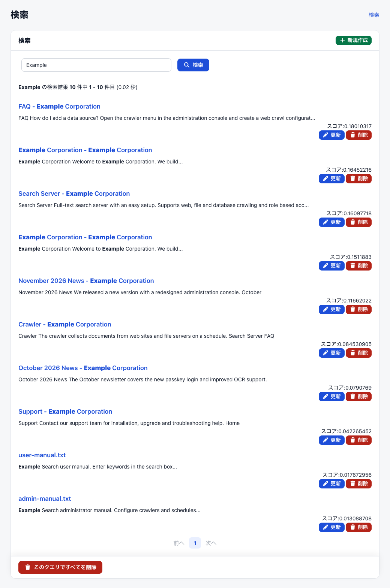
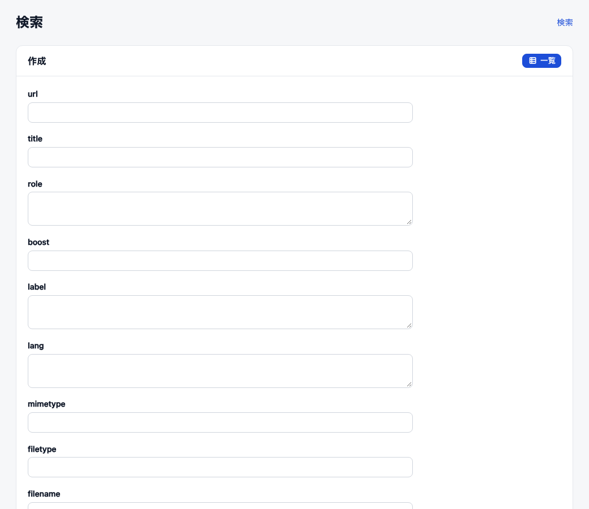

====
検索
====

概要
====

ここでは、管理用検索について説明します。

管理方法
======

表示方法
------

下図の検索ページを開くには、左メニューの [システム情報 > 検索] をクリックします。

|image0|

検索一覧
------

指定した条件で検索することができます。
通常の検索画面ではロールやブラウザーの条件が暗黙的に付加されますが、この管理用検索では付加されません。
表示された検索結果のドキュメントは、更新ボタンで編集できます。また、削除ボタンをクリックし、確認ダイアログの削除ボタンをクリックすると、特定のドキュメントをインデックスから削除することもできます。

一括削除
------

インデックスからすべてのドキュメントを削除したい場合は、「\*:\*」で「このクエリですべてを削除」ボタンをクリックすることで削除されます。
検索条件を指定して対象のドキュメントだけを削除することも可能です。確認ダイアログが表示されます。

ドキュメントの作成
------------------

ページ右上の新規作成ボタンをクリックすると、インデックスにドキュメントを追加するためのフォームが表示されます。

|image1|

フォームにはドキュメントのフィールドが、 ``url`` 、 ``title`` 、 ``role`` などのフィールド名で表示されます。 ``url`` と ``title`` は必須です。

- ``role`` 、 ``label`` 、 ``lang`` 、 ``virtual_host`` など複数の値を持てるフィールドはテキストエリアです。1行に1つの値を入力します。
- ``boost`` は数値、 ``content_length`` 、 ``favorite_count`` 、 ``click_count`` は整数です。
- 日付のフィールド（ ``created`` 、 ``timestamp`` 、 ``last_modified`` 、 ``expires`` ）は ``yyyy-MM-ddTHH:mm:ss.SSSZ`` の形式（例: ``2026-01-01T00:00:00.000Z`` ）で入力します。

これらの値の形式は、フォームを送信するときにブラウザーが確認します。作成ボタンをクリックするとドキュメントが追加されます。
ドキュメントを更新するフォームも同じフィールドです。

