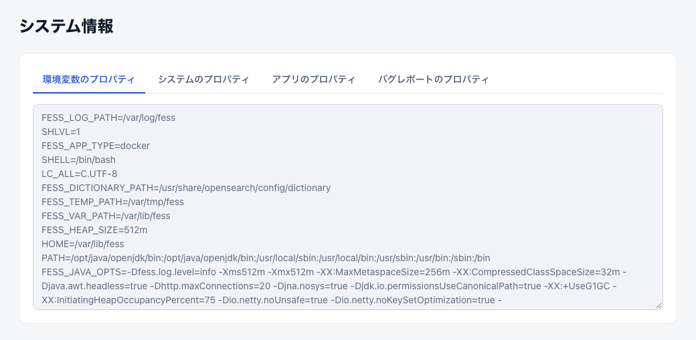
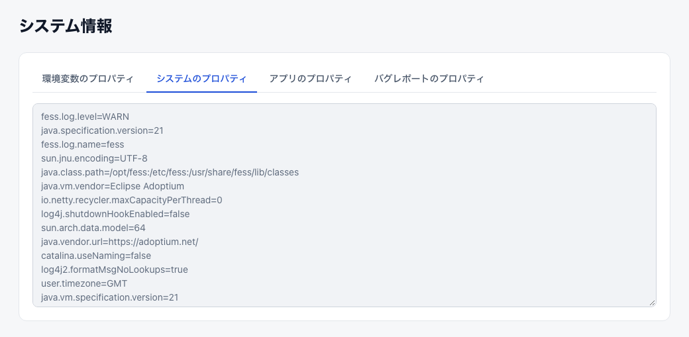
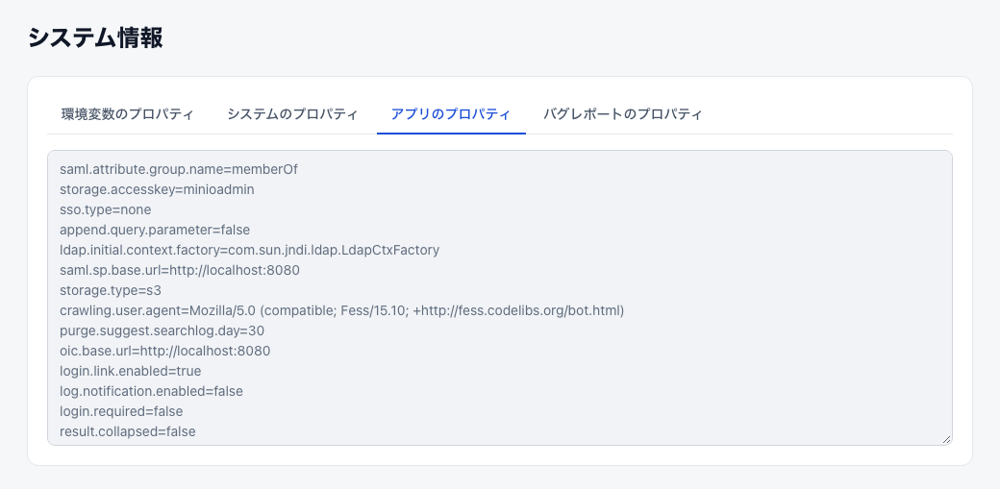
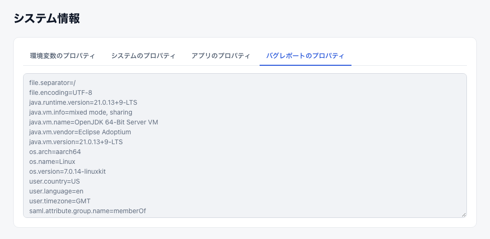

=========
システム情報
=========

概要
====

ここでは、現在稼働中のシステムに関する環境変数などのプロパティ情報を確認できます。

管理方法
======

表示方法
------

下図のシステム情報ページを開くには、左メニューの [システム情報 > 設定情報] をクリックします。
ページには4つのタブがあり、以下で説明します。

表示項目
------

環境変数のプロパティ
:::::::::::::::

|image0|

サーバーの環境変数を一覧できます。

システムのプロパティ
:::::::::::::::

|image1|

|Fess| に設定されたシステムプロパティを一覧できます。

アプリのプロパティ
::::::::::::::

|image2|

|Fess| の設定情報を確認できます。

バグレポートのプロパティ
::::::::::::::::::

|image3|

バグを報告する際に添付するためのプロパティ一覧です。
個人情報が含まれない値を抽出しています。

