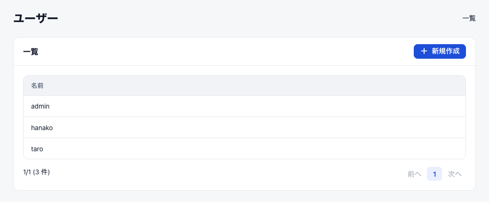
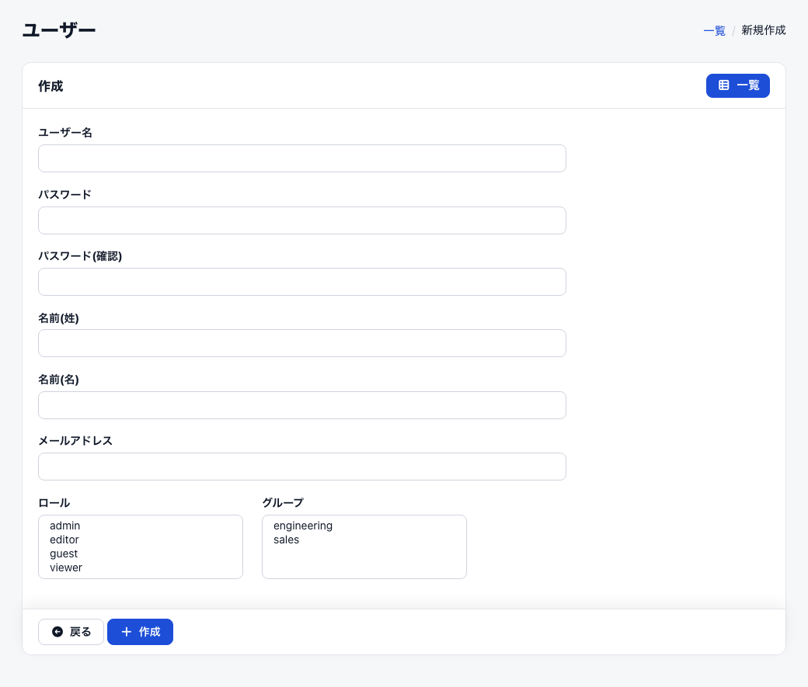

======
ユーザー
======

概要
====

|Fess| にログインするユーザーを管理することができます。

管理方法
======

表示方法
------

下図のユーザーの設定一覧ページを開くには、左メニューの [ユーザー > ユーザー] をクリックします。

|image0|

編集するには設定名をクリックします。

設定の作成
--------

ユーザーの設定ページを開くには新規作成ボタンをクリックします。

|image1|

設定項目
------

ユーザー名
::::::::

ユーザー名を指定します。ユーザーの作成後は変更できません。

パスワード、パスワード(確認)
::::::::::::::::::::::::::::::

ユーザーのパスワードを指定し、パスワード(確認)にも同じパスワードを入力します。ユーザーを作成するときは必須です。ユーザーを編集するときは、両方を空欄にすると現在のパスワードがそのまま使われます。

名前(姓)、名前(名)、メールアドレス
::::::::::::::::::::::::::::::::::::

ユーザーの姓、名、メールアドレスを指定します。いずれも省略できます。

ロール
:::::

ユーザーが属するロールを指定します。

.. note::

   ``admin-user`` ロールを持つユーザーは、管理者ロールを含む既存の任意のロールを任意のユーザーに付与できます。``admin-*`` ロールは管理者ロールと同等として扱ってください。詳しくは :doc:`../install/security` を参照してください。

グループ
::::::

ユーザーが属するグループを指定します。

.. note::

   ユーザーのパスワード、ロール、グループを変更すると、そのユーザーのログインセッションは、最大でおよそ 60 秒（ ``password.changed.check.interval`` の既定値）以内に終了し、再度のログインが必要になります。パスワードを変更した場合、変更を行ったセッションは終了しません。ロールやグループを変更した場合は、変更を行ったセッションも終了します。詳しくは :doc:`../install/security` を参照してください。

設定の削除
--------

一覧ページの設定名をクリックし、削除ボタンをクリックすると確認ダイアログが表示されます。
ダイアログの削除ボタンを押すと設定が削除されます。

