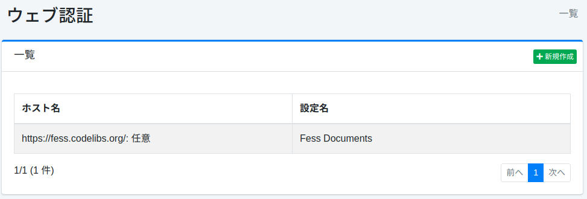
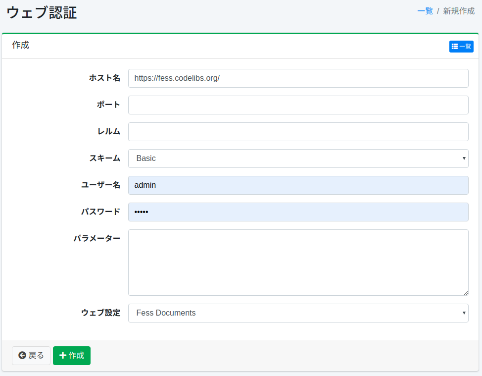

========
ウェブ認証
========

概要
====

ここでは、ウェブを対象としたクロールに対して、ウェブ認証が必要な場合の設定方法について説明します。 
|Fess| は BASIC 認証、DIGEST 認証、NTLM 認証、FORM 認証に対するクロールに対応しています。

管理方法
======

表示方法
------

下図のウェブ認証の設定一覧ページを開くには、左メニューの [クローラー > ウェブ認証] をクリックします。

|image0|

編集するには設定名をクリックします。

設定の作成
--------

ウェブ認証の設定ページを開くには新規作成ボタンをクリックします。

|image1|

設定項目
------

ホスト名
::::::

認証が必要なサイトのホスト名を指定します。
省略した場合は、指定したウェブクロール設定において、任意のホスト名で適用されます。

.. warning::

   ホスト名を省略すると、クロールがリンクやリダイレクトでたどった別のホストにも、このユーザー名とパスワードが送信されます。
   資格情報を意図しないホストに送らないために、ホスト名を指定してください。

ポート
:::::

認証が必要なサイトのポートを指定します。
すべてのポートに対して適用したい場合は、ポートを空欄にします。 ``-1`` は指定できず、 ``0`` 以上の値だけを入力できます。
その場合は、指定したウェブクロール設定において、任意のポートで適用されます。

レルム
:::::

認証が必要なサイトのレルム名を指定します。
省略した場合は、指定したウェブクロール設定において、任意のレルム名で適用されます。
BASIC 認証と DIGEST 認証では、サーバーが返すレルム名と大文字小文字を区別して比較し、一致しない場合は資格情報を送信しません。
NTLM 認証のチャレンジにはレルム名が含まれないため、NTLM 認証ではこの項目は使われません（誤ったレルム名を指定しても認証されます）。

スキーム
::::::

認証方法を選択します。
BASIC 認証、DIGEST 認証、NTLM 認証または FORM 認証を利用することができます。

.. note::

   BASIC 認証、DIGEST 認証、NTLM 認証のスキームは、サーバーに要求させる認証方式を制限するものではありません。
   |Fess| は、サーバーが要求した認証方式で資格情報を送信します。
   たとえば、DIGEST 認証で登録していても、サーバーが BASIC 認証を要求した場合は BASIC 認証で送信されます（HTTP では資格情報が実質的に平文で流れます）。
   BASIC 認証で登録していて、サーバーが DIGEST 認証を要求した場合は、DIGEST 認証で応答します。
   NTLM 認証と、BASIC 認証または DIGEST 認証は互いに代わりになりません。
   サーバーが使っていない認証方式のスキームを選択すると、資格情報は送信されず、そのサイトの文書は索引されません。
   サーバーが使っている認証方式を選択し、可能であれば HTTPS を使用してください。

ユーザー名
::::::::

認証サイトにログインするためのユーザー名を指定します。
NTLM 認証でドメインが必要な場合は、ユーザー名に ``ドメイン名\ユーザー名`` の形式を使わず、ドメインを後述のパラメーターの ``domain`` で指定してください。
``ドメイン名\ユーザー名`` と入力しても分解されず、その文字列全体がユーザー名として、ドメインを空にして送信されます。

パスワード
::::::::

認証サイトにログインするためのパスワードを指定します。

パラメーター
:::::::::

認証サイトにログインするために必要な設定値がある場合に設定します。
NTLM認証の場合、workstationとdomainの値を設定することができます。
設定する場合には以下のように記述します。

::

    workstation=HOGE
    domain=FUGA

``domain``
    認証を行うドメイン名です。ドメインのアカウントで認証する場合に指定します。
    省略するとドメインを空にして送信され、ドメインのアカウントでは認証に失敗します。
    小文字で指定しても、大文字に変換されて送信されます。

``workstation``
    NTLM のメッセージに含めるワークステーション名です。
    省略すると、 |Fess| が動作しているホストのホスト名が送信されます。

ウェブ設定
::::::::

上記の認証設定を適用するウェブ設定名を選択します。
ウェブクロール設定を事前に登録しておく必要があります。

認証に失敗した場合
------------------

資格情報が誤っている場合や、ホスト名・ポート・レルムが対象のサイトと一致せず資格情報が送信されない場合、サーバーは 401 (Unauthorized) を返し、そのサイトの文書は索引されません。
401 は障害 URL として記録されるため、 :doc:`failureurl-guide` で確認してください。
障害 URL として記録する HTTP ステータスコードは ``crawler.failure.url.status.codes`` で変更できます（ :doc:`../config/crawler-advanced` ）。
なお、401 が返っても、すでに索引にある文書は削除されません。

設定の削除
--------

一覧ページの設定名をクリックし、削除ボタンをクリックすると確認画面が表示されます。
削除ボタンを押すと設定が削除されます。

