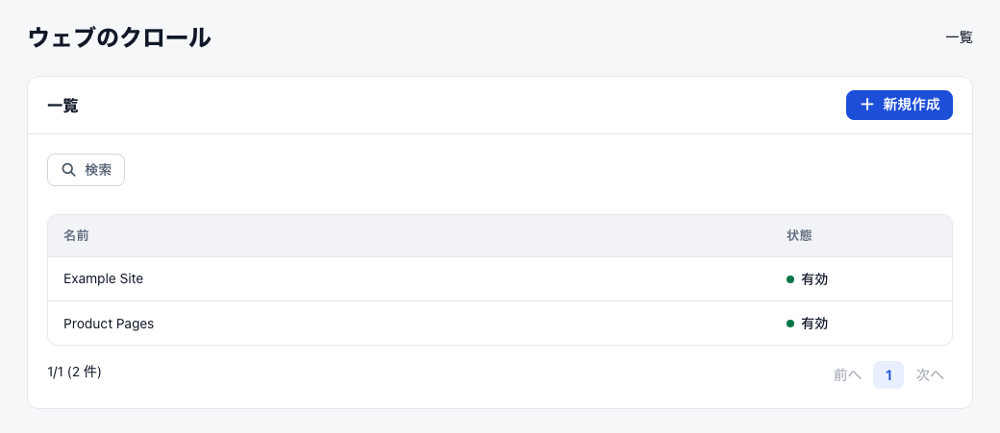
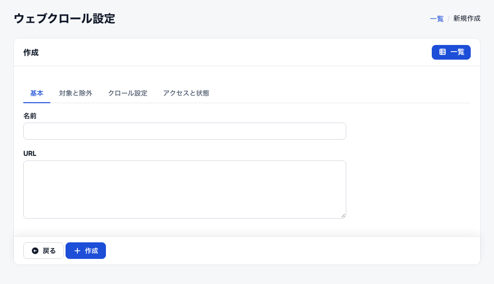
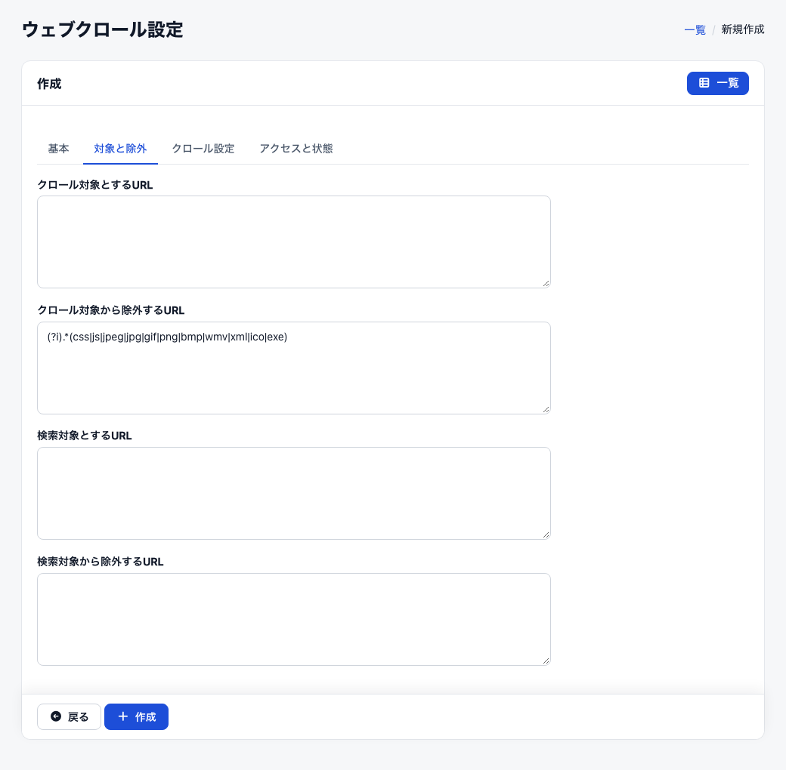
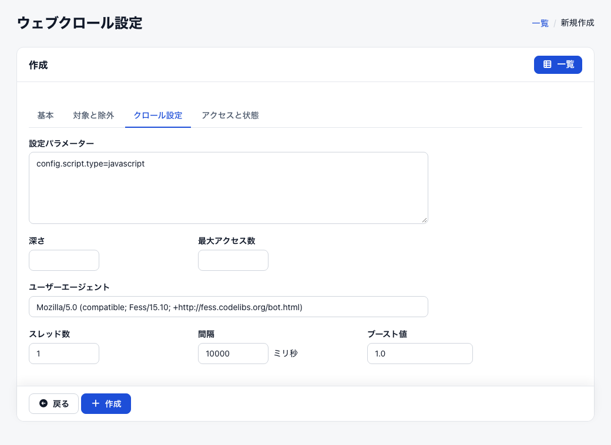
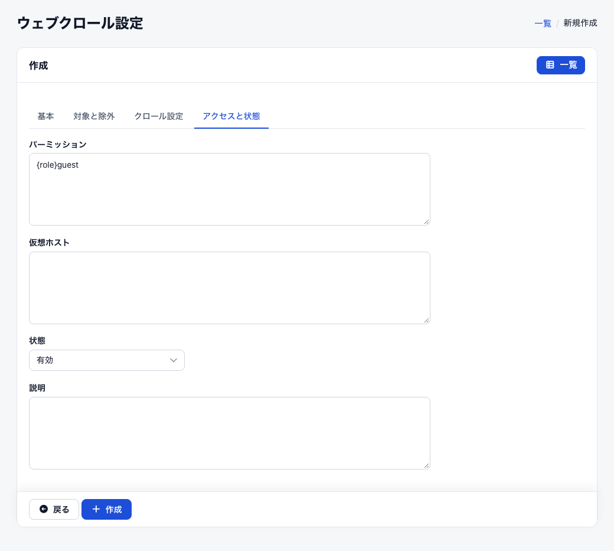

===============================
ウェブクロール（Webサイト検索）
===============================

概要
====

ウェブクロールは、公開 Web サイトやイントラネット内の Web サイトを Web クローラーで巡回し、収集したページを |Fess| のインデックスに登録して全文検索（Webサイト検索）できるようにする機能です。BASIC／DIGEST／NTLM／フォーム認証で保護されたサイトのクロールにも対応しています。

ウェブクロール設定ページではウェブクロールの設定を行います。

管理方法
======

表示方法
------

下図のウェブクロールの設定一覧ページを開くには、左メニューの[クローラー > ウェブ] をクリックします。

|image0|

編集するには設定名をクリックします。

設定の作成
--------

ウェブクロールの設定ページを開くには新規作成ボタンをクリックします。
ページは「基本」「対象と除外」「クロール設定」「アクセスと状態」の4つのタブに分かれています。タブ名をクリックすると表示が切り替わります。入力にエラーがある場合は、エラーを含むタブが自動的に開きます。各タブの項目を以下に説明します。

「基本」タブ
------------

|image1|

名前
::::

設定名。

URL
::::

クロールの始点となるURL。複数指定する場合は1行に1つ記述します。

「対象と除外」タブ
------------------

|image2|

クロール対象とするURL
:::::::::::::::::

この項目で指定した正規表現(Javaフォーマット)にマッチするURLは |Fess| クローラーの対象となります。

クロール対象から除外するURL
:::::::::::::::::::::

この項目で指定した正規表現(Javaフォーマット)にマッチするURLは |Fess| クローラーの対象となりません。

.. note::
   管理画面の新規作成フォームでは、この項目に ``(?i).*(css|js|jpeg|jpg|gif|png|bmp|wmv|xml|ico|exe)`` が既定値として入力されています。パターンはURL全体との一致で判定され、クロールの開始URLにも適用されます。既定値は、 ``css`` ・ ``js`` ・ ``xml`` などの語で終わるURL(大文字小文字は区別しません)に一致するため、 ``sitemap.xml`` のようなURLを開始URLに指定すると、取得されず、何もクロールされません。そのようなURLをクロールする場合は、既定値から該当する語を取り除いてください。開始URLがこの項目のパターンに一致した場合は、設定名・開始URL・一致したパターンが ``fess-crawler.log`` に WARN で出力されます。

検索対象とするURL
::::::::::::::

この項目で指定した正規表現(Javaフォーマット)にマッチするURLは検索の対象となります。

検索対象から除外するURL
::::::::::::::::::

この項目で指定した正規表現(Javaフォーマット)にマッチするURLは検索の対象となりません。

.. note::
   この指定が効くのは、以後のクロールで索引する文書です（一致した文書は索引されません）。すでに索引されている文書は、この指定を追加しても削除されず、検索結果に残ります。全般設定の「最終更新日時の確認」が有効（既定）で更新のない文書は、クロールのたびに有効期限が延長されるため（ :doc:`general-guide` の「最終更新日時の確認」を参照）、「以前のドキュメントを削除」の期限が来ても消えるとは限りません。検索結果から確実に消したい文書は、検索リスト（管理画面）で削除してください。削除した文書は、この指定に一致する間、次のクロールで再び索引されません。

「クロール設定」タブ
--------------------

|image3|

設定パラメーター
::::::::::::

クロール設定情報を指定することができます。

深さ
::::

クロールしたドキュメント内に含まれるリンクをたどる際の深さを指定できます。

最大アクセス数
:::::::::::

インデックスされるurlの数。

ユーザーエージェント
:::::::::::::::

|Fess| クローラーの名前。

スレッド数
::::::::

この設定におけるクロールするスレッド数。

間隔
::::

URLをクロールする際のそれぞれのスレッドにおける時間間隔（ミリ秒）。

ブースト値
::::::::

この設定におけるインデックスされたドキュメントの重み。

「アクセスと状態」タブ
----------------------

|image4|

パーミッション
:::::::::::

この設定のパーミッションを指定します。
パーミッションの指定方法は、たとえば、developerグループに属するユーザーに検索結果を表示させるためには{group}developerと指定します。
ユーザー単位の指定は{user}ユーザー名、ロール単位の指定は{role}ロール名、グループ単位の指定は{group}グループ名で指定します。
``(deny){role}ロール名`` のように ``(deny)`` を付けると、拒否の指定になります。 ``(allow)`` / ``(deny)`` の直後や、行頭に空白（全角空白を含みます）を置いて ``{user}`` ・ ``{group}`` ・ ``{role}`` を続けた記述、 ``(deny)`` や ``{role}`` などを全角文字で入力した記述、 ``(allow)`` / ``(deny)`` の直後や先頭に見えない文字（ゼロ幅スペースやバイトオーダーマークなど）がある記述は、15.10 では保存時にエラーになります。以前のバージョンで保存された値がこの形になっている場合は、入力し直してください。詳しくは :doc:`../config/security-role` を参照してください。

仮想ホスト
::::::::

仮想ホストのホスト名を指定します。複数指定する場合は1行に1つ記述します。
詳しくは :doc:`../config/security-virtual-host` を参照してください。

状態
::::

もし有効であるなら、デフォルトクローラーのスケジュールジョブはこの設定を含みます。

説明
::::

説明を入力できます。

設定の削除
--------

一覧ページの設定名をクリックし、削除ボタンをクリックすると確認ダイアログが表示されます。削除ボタンを押すと設定が削除されます。

.. note::

   設定を削除しても、その設定がすでにインデックスに登録したドキュメントは削除されません。ドキュメントは有効期限が切れるまで検索できます。ドキュメントは、最後にそのドキュメントを登録・更新したクロールの開始時刻から、 :doc:`general-guide` の「以前のドキュメントを削除」（ ``day.for.cleanup`` 、デフォルトは ``3`` ）で指定した日数が経過すると有効期限が切れ、その後 Doc Purger ジョブがインデックスから削除します。 ``-1`` の場合、有効期限なしで登録されたドキュメントはこの方法では削除されません。

   ドキュメントをすぐに削除するには、自分でインデックスから削除してください。検索画面（ :doc:`searchlist-guide` ）で、その設定のドキュメントを検索し（たとえば ``url:`` や ``host:`` で絞り込み）、ヒットしたドキュメントを確認してから「このクエリですべてを削除」ボタンをクリックします。 ``DELETE /api/admin/searchlist/query`` でも同じことができます（ :doc:`../api/admin/api-admin-searchlist` を参照）。

   設定のアクセス権限を変更して再度クロールする場合は異なります。ドキュメントIDはアクセス権限によって決まり、クローラーはドキュメントを登録するときに、同じ設定が以前に登録した、同じURLで異なるIDのドキュメントを削除します。

例
==

fess.codelibs.org をクロールする
-----------------------------

https://fess.codelibs.org/ 以下のページをクロールするウェブクロール設定を作る場合、下のような設定値にします。

.. tabularcolumns:: |p{4cm}|p{8cm}|
.. list-table::
   :header-rows: 1

   * - 設定項目
     - 設定値
   * - 名前
     - Fess
   * - URL
     - https://fess.codelibs.org/
   * - クロール対象とするURL
     - https://fess.codelibs.org/.\*

他の設定値はデフォルト値を使用します。

ウェブ認証サイトのウェブクロール
------------------------

Fess は BASIC 認証と DIGEST 認証と NTLM 認証に対するクロールに対応しています。
ウェブ認証についての詳細はウェブ認証ページを参考にしてください。

Redmine
:::::::

パスワードで保護されているRedmine(例. https://<server>/)のページをクロールするウェブクロール設定を作る場合、下のような設定値にします。

.. tabularcolumns:: |p{4cm}|p{8cm}|
.. list-table::
   :header-rows: 1

   * - 設定項目
     - 設定値
   * - 名前
     - Redmine
   * - URL
     - https://<server>/my/page
   * - クロール対象とするURL
     - https://<server>/.\*
   * - 設定パラメーター
     - client.robotsTxtEnabled=false (Optional)

そのあと、下記のような設定値でウェブ認証の設定の作成を行います。

.. tabularcolumns:: |p{4cm}|p{8cm}|
.. list-table::
   :header-rows: 1

   * - 設定項目
     - 設定値
   * - スキーム
     - Form
   * - ユーザー名
     - (Account for crawling)
   * - パスワード
     - (Password for the account)
   * - パラメーター
     - | encoding=UTF-8
       | token_method=GET
       | token_url=https://<server>/login
       | token_pattern=name="authenticity_token"[^>]+value="([^"]+)"
       | token_name=authenticity_token
       | login_method=POST
       | login_url=https://<server>/login
       | login_parameters=username=${username}&password=${password}
   * - ウェブ設定
     - Redmine

XWiki
:::::

XWiki(例. https://<server>/xwiki/)のページをクロールするウェブクロール設定を作る場合、下のような設定値にします。

.. tabularcolumns:: |p{4cm}|p{8cm}|
.. list-table::
   :header-rows: 1

   * - 設定項目
     - 設定値
   * - 名前
     - XWiki
   * - URL
     - https://<server>/xwiki/bin/view/Main/
   * - クロール対象とするURL
     - https://<server>/.\*
   * - 設定パラメーター
     - client.robotsTxtEnabled=false (Optional)

そのあと、下記のような設定値でウェブ認証の設定の作成を行います。

.. tabularcolumns:: |p{4cm}|p{8cm}|
.. list-table::
   :header-rows: 1

   * - 設定項目
     - 設定値
   * - スキーム
     - Form
   * - ユーザー名
     - (Account for crawling)
   * - パスワード
     - (Password for the account)
   * - パラメーター
     - | encoding=UTF-8
       | token_method=GET
       | token_url=http://<server>/xwiki/bin/login/XWiki/XWikiLogin
       | token_pattern=name="form_token" +value="([^"]+)"
       | token_name=form_token
       | login_method=POST
       | login_url=http://<server>/xwiki/bin/loginsubmit/XWiki/XWikiLogin
       | login_parameters=j_username=${username}&j_password=${password}
   * - ウェブ設定
     - XWiki

関連ページ
==========

- :doc:`../config/crawler-basic`
- :doc:`webauth-guide`
- :doc:`fileconfig-guide`
- :doc:`../config/search-basic`

.. pdf            :height: 940 px
