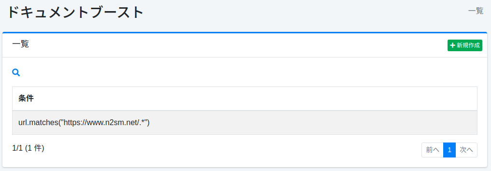
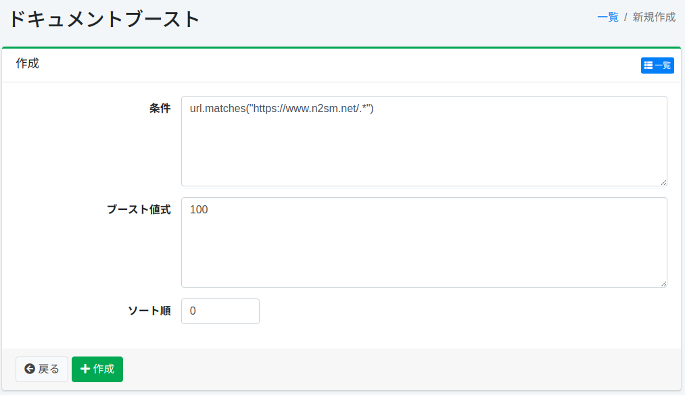

===============
ドキュメントブースト
===============

概要
====

ここでは、ドキュメントブーストに関する設定について説明します。
ドキュメントブーストの設定を行うことで、検索語に関わらず検索結果の上位にドキュメントを位置づけることができます。

管理方法
======

表示方法
------

下図のドキュメントブーストの設定一覧ページを開くには、左メニューの [クローラー > ドキュメントブースト] をクリックします。

|image0|

編集するには設定名をクリックします。

設定の作成
--------

ドキュメントブーストの設定ページを開くには新規作成ボタンをクリックします。

|image1|

設定項目
------

条件
::::

上位に位置づけたいドキュメントの条件を指定します。
たとえば、https://www.n2sm.net/を含むURLを上位に表示したい場合は、url.matches("https://www.n2sm.net/.\*")を記述します。
条件は、下記の「スクリプト種別」で指定したスクリプトエンジンの構文で記述します。

ブースト値式
:::::::::

ドキュメントの重み付けの値を指定します。
式は、下記の「スクリプト種別」で指定したスクリプトエンジンの構文で記述します。

スクリプト種別
::::::::::::::

条件およびブースト値式を評価するスクリプトエンジンを指定します。
新規作成時は ``javascript`` があらかじめ入力されています。 ``groovy`` を指定する場合は
``fess-script-groovy`` プラグインが必要です。未入力の場合はGroovyとして評価されます。

.. warning::

   JavaScriptでは、条件およびブースト値式を末尾のセミコロンを付けない式として記述してください。
   文のブロックとしてしか解析できない文字列は、明示的な ``return`` を含まない限り ``null`` と
   評価されます。 :ref:`javascript-statement-null` （ :doc:`../config/scripting-javascript` ）
   を参照してください。

ソート順
::::::

ドキュメントブーストのソート順を設定します。

ルールが適用されるタイミング
----------------------------

ドキュメントブーストのルールは、Webクロールまたはファイルクロールでドキュメントをインデックスに登録するときに評価されます。データストアクロールには適用されません。
ルールを追加・変更・削除しても、すでにインデックスにあるドキュメントのブースト値は変わりません。

[システム > 全般] の「最終更新日時の確認」が有効な場合（既定）、内容が変わっていないドキュメントは再クロールしてもインデックスに登録し直されないため、ブーストは再評価されません。
追加・変更したルールを既存のドキュメントに反映するには、対象のドキュメントをインデックスから削除（ :doc:`searchlist-guide` ）してから、クロールし直してください。
内容が更新されたドキュメントなど、インデックスに登録し直されるドキュメントは、そのときにルールが評価されます。
「最終更新日時の確認」を無効にすると、クロールのたびにすべてのドキュメントが登録し直されるため、ルールも毎回評価されます。

設定の削除
--------

一覧ページの設定名をクリックし、削除ボタンをクリックすると確認画面が表示されます。削除ボタンを押すと設定が削除されます。

