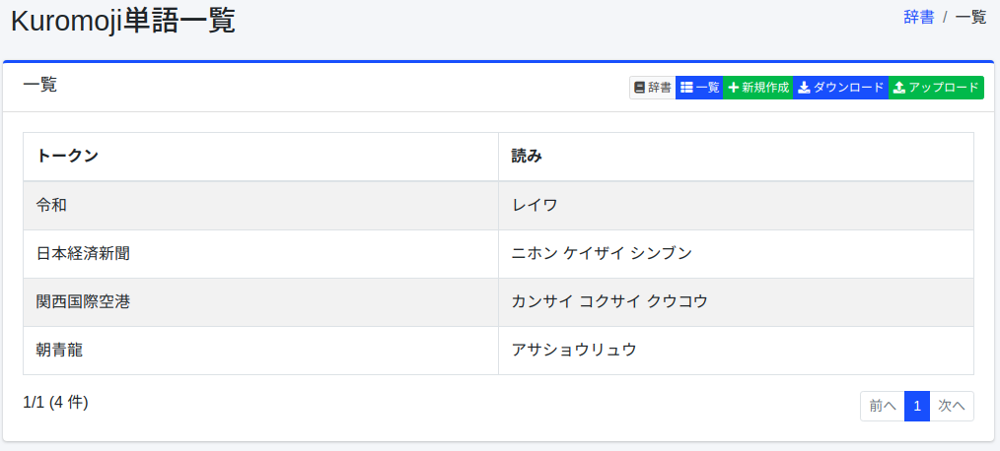
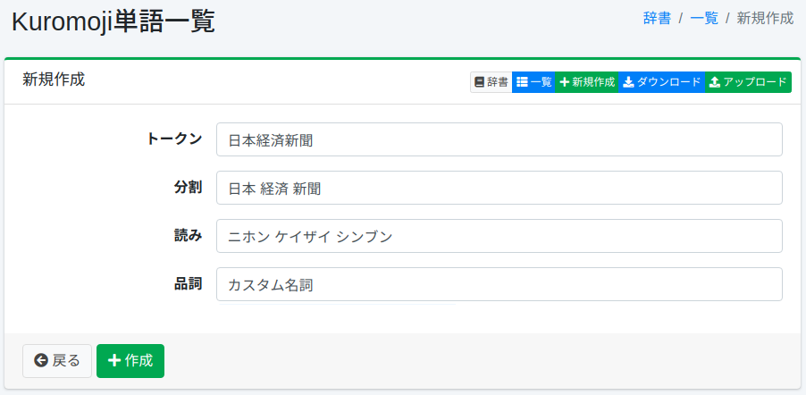

===========
Kuromoji辞書
===========

概要
====

人名、固有名詞、専門用語などを形態素解析用に登録することができます。

この辞書は日本語用（ ``ja/kuromoji.txt`` ）で、 ``content_ja`` などの ``_ja`` フィールドの解析にだけ使われます。
保存しただけでは検索に反映されません。反映の手順は :ref:`dict-apply-changes` を参照してください。この辞書はインデックス時に効くため、すでにインデックスにあるドキュメントには、クロールし直すまで反映されません。

管理方法
======

表示方法
------

下図のKuromojiの設定一覧ページを開くには、左メニューの [システム > 辞書] を選択した後、kuromojiをクリックします。

|image0|

編集するには設定名をクリックします。

設定方法
------

Kuromojiの設定ページを開くには新規作成ボタンをクリックします。

|image1|

設定項目
------

トークン
::::::

形態素解析で処理する単語を入力します。

分割
::::

単語が複合語から構成される場合、分割した単語で検索されてもヒットするようにできます。
たとえば、「全文検索エンジン」を「全文 検索 エンジン」と入力することで、分割した単語でも検索できるようにします。

読み
::::

トークンとして入力した単語の読みをカタカナで入力します。
分割を行った場合は分割して入力します。
たとえば、「ゼンブン ケンサク エンジン」と入力します。

品詞
::::

入力した単語の品詞を入力します。

ダウンロード
=========

Kuromojiの辞書形式でダウンロードすることができます。

アップロード
=========

Kuromojiの辞書形式でアップロードすることができます。
Kuromojiの辞書形式はカンマ(,)区切りで、「トークン,分割トークン,分割トークンの読み,品詞」になります。
分割トークンはスペース区切りで分割します。
分割する必要がない場合はトークンと分割トークンは等しくなります。
たとえば、以下のようになります。

::

    朝青龍,朝青龍,アサショウリュウ,カスタム名詞
    関西国際空港,関西 国際 空港,カンサイ コクサイ クウコウ,カスタム名詞

.. warning::

   アップロードすると、辞書の内容がアップロードしたファイルの内容に置き換わります。画面から登録した語を含め、ファイルにない語は消えます。必要な場合は、先にダウンロードして控えを取り、その内容を含めてアップロードしてください。

.. note::

   同梱の辞書には、上の2つの例（「朝青龍」「関西国際空港」）があらかじめ登録されています。
   なお、 ``content_ja`` の解析では、形態素解析の前に文字置換辞書 ``ja/mapping.txt`` で文字が置き換えられます（ :doc:`mapping-guide` ）。同梱の ``ja/mapping.txt`` には ``龍 => 竜`` があるため、「朝青龍」は ``朝青竜`` に置き換えられてから解析されるため、辞書の「朝青龍」には一致せず、 ``朝 青 竜`` と分かれます。
   登録の効果を確かめるときは、辞書に登録していない語で、 ``ja/mapping.txt`` で置き換えられる文字を含まないものを使ってください。

