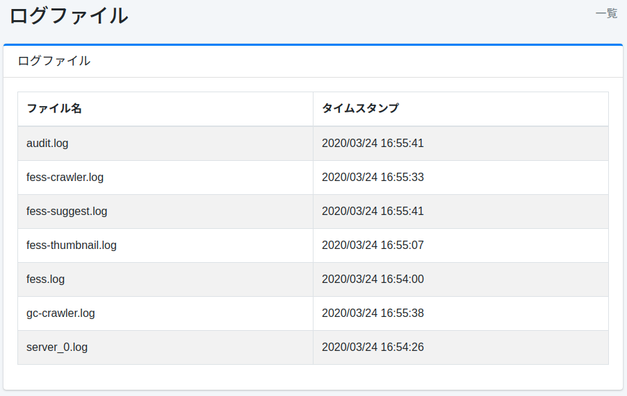

=========
ログファイル
=========

概要
====

ここでは、 |Fess| で出力されるログファイルのダウンロードについて説明します。

設定方法
======

表示方法
------

下図のログファイルページを開くには、左メニューの [システム情報 > ログファイル] をクリックします。

|image0|

ダウンロード
---------

表示されているログファイル名をクリックすると、ログファイルをダウンロードすることができます。

``server_*.log``
::::::::::::::::

|Fess| のアプリケーションサーバーとしてのログが記録されます。

fess.log
::::::::

|Fess| のアプリケーションとしてのログが記録されます。

fess-crawler.log
::::::::::::::::

クローラーのログが記録されます。

audit.log
:::::::::

ログイン情報や管理画面のアクセスログが記録されます。

fess-thumbnail.log
::::::::::::::::::

サムネイル機能のログが記録されます。

fess-suggest.log
::::::::::::::::

サジェスト機能のログが記録されます。

fess-urls.log
:::::::::::::

1つのクロールにかかった時間が記録されます。

searchlog.log
:::::::::::::

検索ログが記録されます。
[システム > 全般] の「検索ログ」が有効な場合、デフォルトの設定では検索のたびに 1 行（JSON）が追記されます。
1 行には、その検索で返したドキュメントのフィールド（ ``logging.search.docs.fields`` ）が含まれるため、大きさは返した件数に応じて増えます（ ``num=100`` では 1 行が 70 KB 前後になる例があります）。
ログのローテーションと保持期間は :doc:`../config/admin-logging` を参照してください。
返したドキュメントのフィールドを検索ログに含めないようにするには ``fess_config.properties`` で ``logging.search.docs.enabled=false`` を、このファイルに出力しないようにするには ``logging.search.use.logfile=false`` を設定します。

gc-crawler.log
::::::::::::::

クローラープロセスのGCログが記録されています（デフォルトの「Default Crawler」ジョブが出力します）。

gc-fess.log
:::::::::::

|Fess| 本体のGCログが記録されています。環境変数 ``FESS_USE_GC_LOGGING`` に空でない値を設定した場合にだけ出力されます（詳しくは :doc:`../install/run` を参照してください）。

