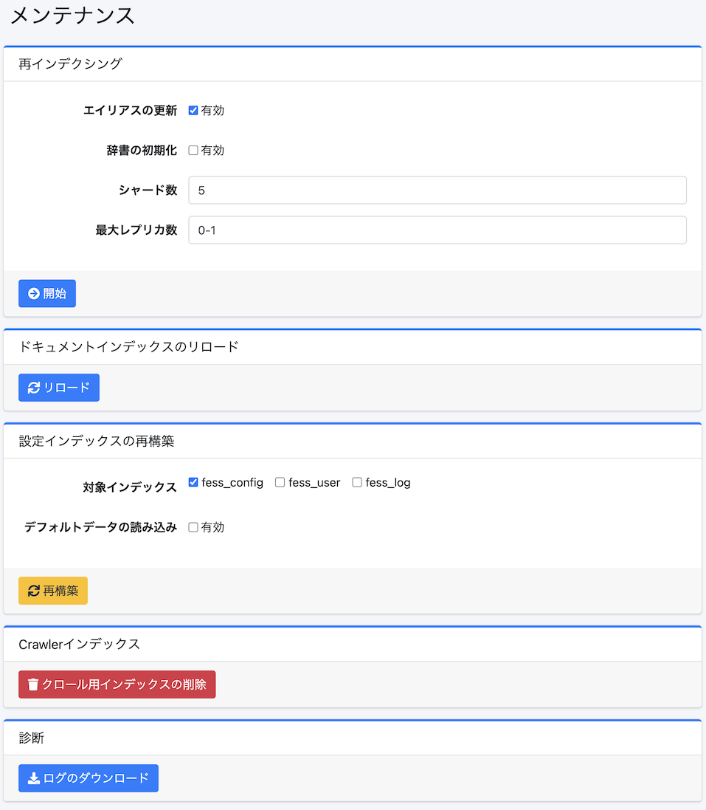

=========
メンテナンス
=========

概要
====

メンテナンスページはシステムのデータ操作を実行するときに利用します。

|image0|

操作方法
======

再インデクシング
------------

既存のfessインデックスから新しいインデックスを再作成することができます。
インデックスのマッピングを変更したい場合などで実行します。

設定項目
------

エイリアスの更新
::::::::::::

有効にすることで、再インデクシングが完了した後に既存のインデックスに割り当ててあるfess.searchとfess.updateのエイリアスを新しいインデックスに張り替えることができます。

辞書の初期化
:::::::::

有効にすることで、辞書の設定を初期化することができます。

``search_engine.type`` が ``vanilla`` または ``aws`` の場合、この項目は表示されません。

シャード数
::::::::

OpenSearchのシャード数(index.number_of_shards)を指定することができます。

最大レプリカ数
:::::::::::

OpenSearchの最大レプリカ数(index.auto_expand_replicas)を指定することができます。

設定インデックスの再構築
--------------------------

設定インデックス（fess_config、fess_user、fess_log）を最新のマッピングで再構築することができます。
この操作はバックグラウンドで実行されます。実行する前には設定のバックアップ等を取得しておいてください。

対象インデックス
::::::::::::

再構築するインデックスを選択します。fess_config、fess_user、fess_logから選択できます。

デフォルトデータの読み込み
::::::::::::::::

有効にすることで、再構築時にデフォルトデータを読み込むことができます。既存のドキュメントは上書きされません。

ドキュメントインデックスのリロード
--------------------------

インデックスの設定を反映させるために、ドキュメントインデックスをリロードすることができます。
辞書の変更を検索に反映するときにも使います。保存済みの辞書を OpenSearch のファイルへ書き出してから、
``fess.update`` エイリアスが指すインデックスを close して open します。close している間は
そのインデックスを検索できません。詳しくは :ref:`dict-apply-changes` を参照してください。

``search_engine.type`` が ``vanilla`` または ``aws`` の場合、この機能は表示されません。

Crawlerインデックス
----------------

fess_crawlerインデックス(クロール情報)を削除することができます。
クローラーの実行中には実行しないでください。

診断
----

診断用の zip ファイルをダウンロードできます。zip の ``log<yyyyMMddHHmm>/`` ディレクトリの下に、次のファイルが入ります。

- ログディレクトリにある ``*.log`` と ``*.log.gz`` （ ``fess.log`` 、 ``fess-crawler.log`` 、 ``audit.log`` 、 ``searchlog.log`` など）
- ``system.properties`` （システム設定）と ``fess_config.properties`` （アプリケーション設定）
- ``fess_basic_config.bulk`` （クロール設定、認証設定、ラベルなど設定インデックスの内容。管理 API のアクセストークンは含まれません）
- ``es_cat_*.txt`` と ``es_*.json`` （OpenSearch の ``_cat`` API の出力と、クラスタ・ノード・タスクなどの状態）

``system.properties`` と ``fess_config.properties`` では、システム情報画面と同じ規則で秘密の値を ``XXXXXXXX`` に置き換えます。対象は、ストレージの秘密鍵、Webhook URL（Slack・Google Chat）、SSO のクライアントシークレット、LLM・埋め込みの API キー、アプリケーションの暗号鍵（ ``app.cipher.key`` ）などです。キーは残るので、どの設定があるかは分かります。

.. note::

   ログファイルと ``fess_basic_config.bulk`` の内容はマスクされません。zip を外部へ送る前に、内容を確認してください。

