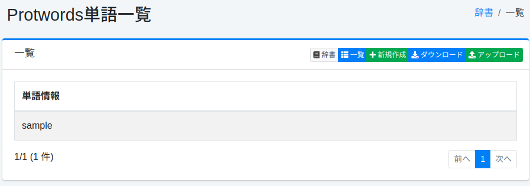
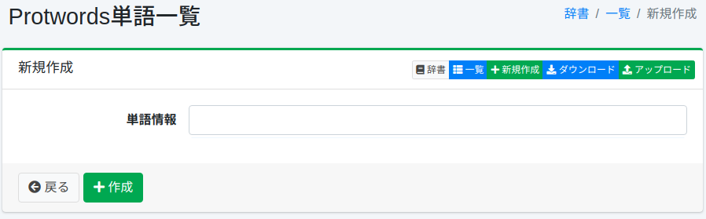

============
Protwords辞書
============

概要
====

ステミング処理の対象から除外する単語を管理することができます。
ステミング処理は基本的にルールベースの処理であるため、意図しない正規化が行われてしまう可能性があります。
例えば、Maine(アメリカの州の名前)という語は main に正規化されてしまいます。

この語をそのまま検索できるようにするには、 ``maine`` を登録します（登録する語は小文字で書きます。詳しくは「設定項目」を参照してください）。

一覧には言語ごとの辞書（ ``en/protwords.txt`` 、 ``de/protwords.txt`` など）が表示されます。登録する語の言語に合った辞書を選んで編集してください。どの辞書がどのフィールドに効くかは :doc:`dict-guide` を参照してください。
保存しただけでは検索に反映されません。反映の手順は :ref:`dict-apply-changes` を参照してください。

管理方法
======

表示方法
------

下図のProtwordsの設定一覧ページを開くには、左メニューの [システム > 辞書] を選択した後、protwordsをクリックします。

|image0|

編集するには設定名をクリックします。

設定方法
------

Protwordsの設定ページを開くには新規作成ボタンをクリックします。

|image1|

設定項目
------

単語情報
::::::

ステミング処理の対象から除外する単語を入力します。

単語は小文字で入力してください。解析は単語を小文字にしてからこの辞書と照合するため、 ``Maine`` と入力しても保護されません。冒頭の例では ``maine`` と入力します。

ダウンロード
=========

Protwordsの辞書形式でダウンロードすることができます。

アップロード
=========

Protwordsの辞書形式でアップロードすることができます。

.. warning::

   アップロードすると、辞書の内容がアップロードしたファイルの内容に置き換わります。画面から登録した単語を含め、ファイルにない単語は消えます。必要な場合は、先にダウンロードして控えを取り、その内容を含めてアップロードしてください。

