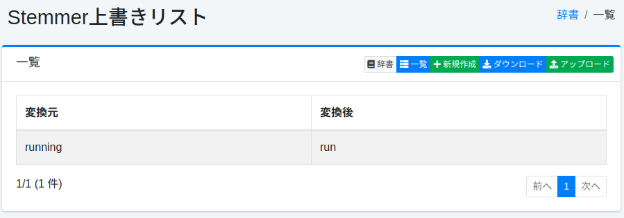
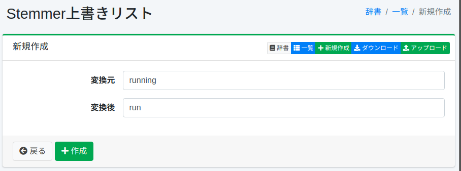

===============
Stemmer上書き辞書
===============

概要
====

特定の語を、指定した語幹(ステム)に上書きさせることができます。ステミング処理の結果が意図と異なる語に使用します。
たとえば、 ``mice`` の語幹を ``mous`` にすることで、 ``mice`` を ``mouse`` と同じ語として検索できます（英語のステマーは ``mouse`` を ``mous`` にするためです）。

記号・文字コード・全角半角などの文字を別の文字に置き換えるのは、この辞書の働きではありません。文字置換辞書（ :doc:`mapping-guide` ）を使用してください。

一覧には言語ごとの辞書（ ``en/stemmer_override.txt`` など）が表示されます。登録する語の言語に合った辞書を選んで編集してください。どの辞書がどのフィールドに効くかは :doc:`dict-guide` を参照してください。
保存しただけでは検索に反映されません。反映の手順は :ref:`dict-apply-changes` を参照してください。

管理方法
======

表示方法
------

下図のStemmer上書きの設定一覧ページを開くには、左メニューの [システム > 辞書] を選択した後、stemmeroverrideをクリックします。

|image0|

編集するには設定名をクリックします。

設定方法
------

Stemmer上書きの設定ページを開くには新規作成ボタンをクリックします。

|image1|

設定項目
------

変換元
:::::

語幹を上書きしたい語を入力します。解析は単語を小文字にしてから照合するため、小文字で入力してください。

変換後
:::::

変換元で入力した語の語幹として使う語を入力します。
変換後の語は、ステミングされずにそのままインデックスされます。検索語はステミングされるため、元の語と同じ検索結果にしたいときは、通常の語をステマーに通した結果（ ``mouse`` なら ``mous`` ）を指定します。
たとえば、変換元に ``mice`` 、変換後に ``mous`` と入力します。

ダウンロード
=========

Stemmer上書きの辞書形式でダウンロードすることができます。

アップロード
=========

Stemmer上書きの辞書形式でアップロードすることができます。

.. warning::

   アップロードすると、辞書の内容がアップロードしたファイルの内容に置き換わります。画面から登録した内容を含め、ファイルにないものは消えます。必要な場合は、先にダウンロードして控えを取り、その内容を含めてアップロードしてください。

