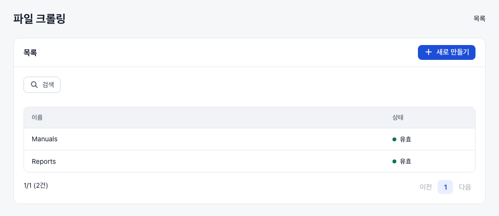
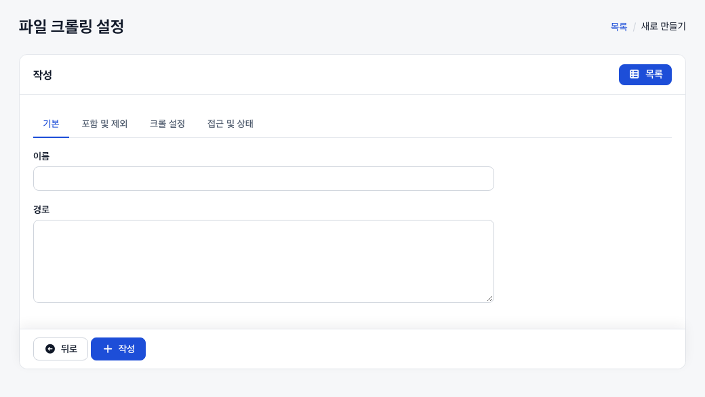
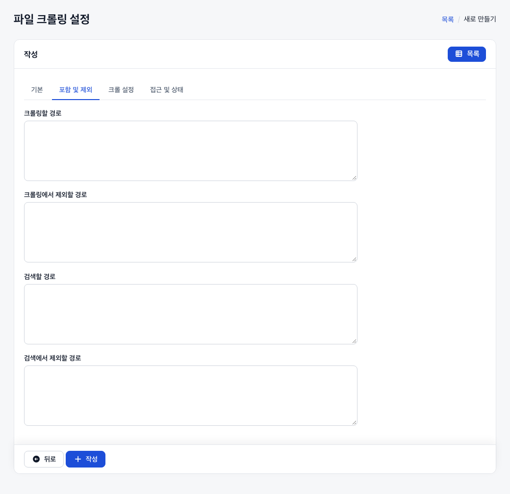
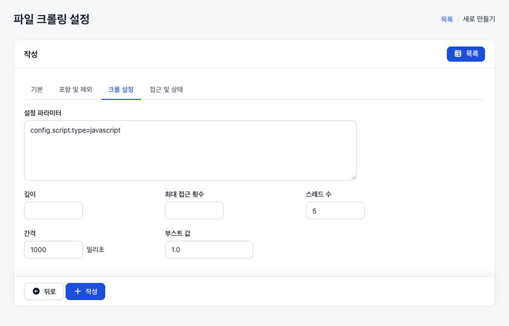
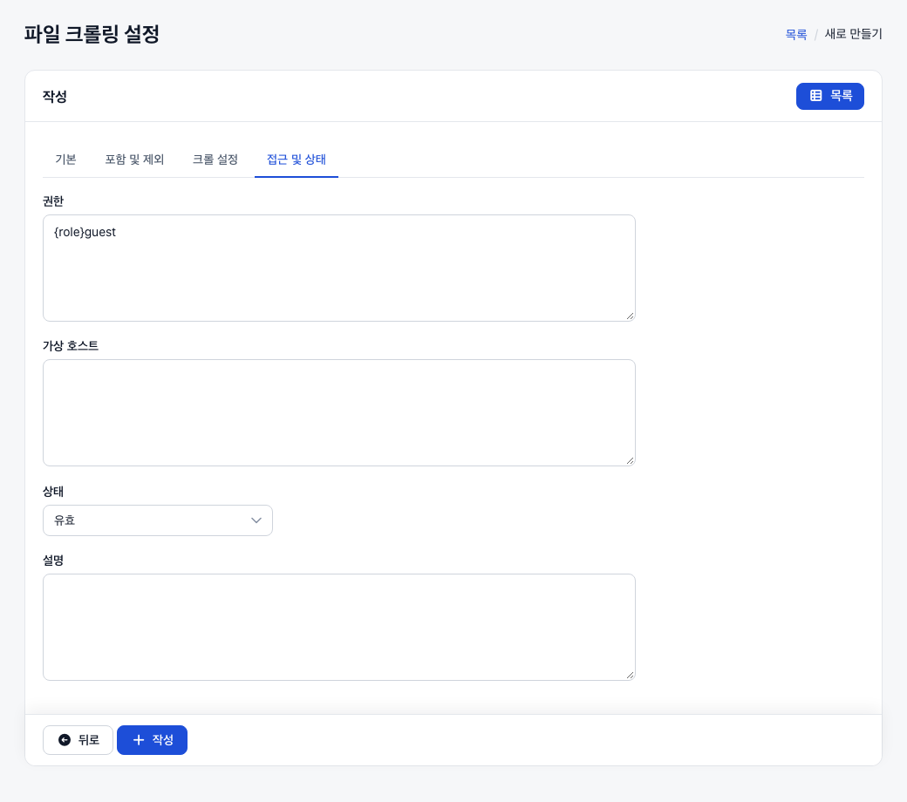

=============================
파일 크롤링(파일 서버 검색)
=============================

개요
====

파일 크롤링은 사내 파일 서버나 Windows 공유 폴더, 클라우드 스토리지에 있는 문서를 |Fess| 의 인덱스에 등록하여 전문 검색(파일 서버 검색)할 수 있도록 하는 기능입니다. Word・Excel・PowerPoint・PDF 등 다양한 파일 형식을 지원합니다.

파일 크롤링 설정 페이지에서는 파일 시스템이나 공유 네트워크의 폴더에 있는 파일을 크롤링하는 설정을 관리할 수 있습니다.

크롤링 대상은 "경로"에 지정하는 프로토콜에 따라 결정됩니다.

- ``file:/`` … 로컬 또는 마운트된 파일 시스템
- ``smb://`` … Windows 파일 서버/공유 폴더(SMB/CIFS)
- ``smb1://`` … 예전 SMB1 프로토콜을 사용하는 Windows 파일 서버/공유 폴더
- ``ftp://`` … FTP 서버
- ``s3://`` … Amazon S3 버킷（ ``fess-storage-s3`` 플러그인 필요）
- ``gcs://`` … Google Cloud Storage 버킷（ ``fess-storage-gcs`` 플러그인 필요）

.. note::
   ``fess-storage-s3`` 플러그인과 ``fess-storage-gcs`` 플러그인은 배포물에 포함되어 있지 않으므로
   관리 화면의 「시스템 > 플러그인」 페이지 또는 ``bin/fess-setup install plugin fess-storage-s3`` ,
   ``bin/fess-setup install plugin fess-storage-gcs`` 로 설치하십시오.

관리 방법
======

표시 방법
------

아래 그림의 파일 크롤링 설정 목록 페이지를 열려면 왼쪽 메뉴의 [크롤러 > 파일 시스템]을 클릭합니다.

|image0|

편집하려면 설정 이름을 클릭합니다.

설정 생성
-------

파일 크롤링 설정 페이지를 열려면 신규 생성 버튼을 클릭합니다.
페이지는 "기본", "포함 및 제외", "크롤 설정", "접근 및 상태"의 4개 탭으로 나뉘어 있습니다. 탭 이름을 클릭하면 탭이 전환됩니다. 입력에 오류가 있으면 해당 입력을 포함한 탭이 자동으로 열립니다. 각 탭의 항목은 아래와 같습니다.

기본 탭
-------

|image1|

이름
::::

설정 이름입니다.

경로
::::

이 경로에서 크롤링을 시작할 위치를 지정합니다(예: file:/ 또는 smb://). 한 줄에 하나씩 지정합니다.

포함 및 제외 탭
---------------

|image2|

크롤링 대상 경로
:::::::::::::::::

이 항목에 지정한 정규 표현식(Java 형식)과 일치하는 경로는 |Fess| 크롤러의 대상이 됩니다.

.. note::
   이 패턴은 크롤러가 방문하는 모든 경로(시작 경로와 하위 디렉토리 포함)의 경로 전체에 대해 적용됩니다. ``.*\.(md|rst|adoc)$`` 처럼 확장자만 지정하면 시작 경로와 하위 디렉토리가 패턴과 일치하지 않아 파일에 도달하지 못하므로 아무것도 크롤링되지 않습니다. 확장자로 좁히려면 같은 패턴을 "검색 대상 경로" 에 지정하십시오(디렉토리는 계속 탐색되며 일치하는 파일만 검색 대상이 됩니다). "크롤링 대상 경로" 에는 시작 경로와 하위 디렉토리에도 일치하는 패턴을 지정합니다.

크롤링 대상에서 제외할 경로
:::::::::::::::::::::

이 항목에 지정한 정규 표현식(Java 형식)과 일치하는 경로는 |Fess| 크롤러의 대상이 되지 않습니다.

.. note::
   이 지정이 적용되는 것은 이후 크롤링에서 색인하는 문서입니다(일치한 문서는 색인되지 않습니다). 이미 색인된 문서는 이 지정을 추가해도 삭제되지 않고 검색 결과에 남습니다. 일반 설정의 "최종 갱신 일시 확인"이 활성화되어 있고(기본값) 갱신이 없는 문서는 크롤링할 때마다 만료 시각이 연장되므로( :doc:`general-guide` 의 "최종 갱신 일시 확인" 참조), "이전 문서 삭제"의 기한이 되어도 삭제된다고는 할 수 없습니다. 검색 결과에서 확실하게 없애고 싶은 문서는 검색 목록(관리 화면)에서 삭제하십시오. 삭제한 문서는 이 지정에 일치하는 동안 다음 크롤링에서 다시 색인되지 않습니다.

검색 대상 경로
::::::::::::::

이 항목에 지정한 정규 표현식(Java 형식)과 일치하는 경로는 검색 대상이 됩니다.

검색 대상에서 제외할 경로
::::::::::::::::::

이 항목에 지정한 정규 표현식(Java 형식)과 일치하는 경로는 검색 대상이 되지 않습니다.

크롤 설정 탭
------------

|image3|

설정 파라미터
::::::::::::

크롤링 설정 정보를 지정할 수 있습니다.

``file:`` 로 시작하는 경로(로컬 또는 마운트된 파일 시스템)를 크롤링할 때는 ``client.followSymlink`` 로 심볼릭 링크를 따라갈지 지정할 수 있습니다. 기본값은 ``true`` (따라감)입니다. ``false`` 를 지정하면 심볼릭 링크는 대상에서 제외되고, 링크가 가리키는 파일은 링크를 통해서는 크롤링되지 않습니다(건너뛴 링크는 ``fess-crawler.log`` 에 INFO 레벨로 기록됩니다). 링크를 따라가면 링크가 가리키는 파일이 링크를 포함한 설정의 권한으로 한 번 더 등록되므로, 링크 대상보다 많은 사용자가 읽을 수 있는 공유를 크롤링하는 경우에는 ``false`` 를 고려하십시오.

::

    client.followSymlink=false

깊이
::::

크롤링할 파일 시스템 구조의 깊이를 지정합니다.

최대 접근 횟수
:::::::::::

인덱싱할 경로의 수를 지정합니다.

스레드 수
::::::::

이 설정에 사용할 스레드 수를 지정합니다.

간격
::::

스레드가 경로를 크롤링할 때마다 대기할 시간을 밀리초 단위로 지정합니다.

부스트 값
::::::::

부스트 값은 이 설정으로 인덱싱된 문서의 우선순위입니다.

접근 및 상태 탭
---------------

|image4|

권한
:::::::::::

이 설정의 권한을 지정합니다.
권한 지정 방법은 예를 들어, developer 그룹에 속한 사용자에게 검색 결과를 표시하려면 {group}developer로 지정합니다.
사용자 단위 지정은 {user}사용자명, 역할 단위 지정은 {role}역할명, 그룹 단위 지정은 {group}그룹명으로 지정합니다.

가상 호스트
::::::::

가상 호스트의 호스트명을 한 줄에 하나씩 지정합니다.
자세한 내용은 :doc:`설정 가이드의 가상 호스트 <../config/security-virtual-host>` 를 참조하십시오.

상태
::::

이 설정이 활성화되어 있으면 기본 크롤러의 작업에 이 설정이 포함되어 크롤링을 수행합니다.

설명
::::

설명을 입력할 수 있습니다.

설정 삭제
--------

목록 페이지의 설정 이름을 클릭하고 삭제 버튼을 클릭하면 확인 대화상자가 표시됩니다. 삭제 버튼을 누르면 설정이 삭제됩니다.

.. note::

   설정을 삭제해도 그 설정이 이미 인덱스에 등록한 문서는 삭제되지 않습니다. 문서는 만료될 때까지 검색할 수 있습니다. 문서는 마지막으로 그 문서를 등록·갱신한 크롤링의 시작 시각으로부터 :doc:`general-guide` 의 "이전 문서 삭제"(``day.for.cleanup``, 기본값 ``3``)에 지정한 일수가 지나면 만료되며, 이후 Doc Purger 작업이 인덱스에서 삭제합니다. ``-1`` 인 경우, 만료 시각 없이 등록된 문서는 이 방법으로는 삭제되지 않습니다.

   문서를 즉시 삭제하려면 직접 인덱스에서 삭제하십시오. 검색 화면(:doc:`searchlist-guide`)에서 그 설정의 문서를 검색하고(예: ``url:`` 이나 ``host:`` 로 좁히기), 검색된 문서를 확인한 다음 "이 쿼리로 모두 삭제" 버튼을 클릭합니다. ``DELETE /api/admin/searchlist/query`` 로도 같은 작업을 할 수 있습니다(:doc:`../api/admin/api-admin-searchlist` 참조).

   설정의 접근 권한을 변경하고 다시 크롤링하는 경우는 다릅니다. 문서 ID는 접근 권한에 따라 결정되며, 크롤러는 문서를 등록할 때 같은 설정이 이전에 등록한, URL은 같고 ID가 다른 문서를 삭제합니다.

예
==

로컬 파일 크롤링
--------------------

/home/share 아래의 파일을 크롤링하는 경우 설정은 다음과 같습니다.

.. tabularcolumns:: |p{4cm}|p{8cm}|
.. list-table::
   :header-rows: 1

   * - 이름
     - 값
   * - 이름
     - Share 디렉터리
   * - 경로
     - file:/home/share

다른 매개변수는 기본 설정으로 충분합니다.

Windows 공유 폴더 크롤링
---------------------------

\\SERVER\SharedFolder 아래의 파일을 크롤링하는 경우 설정은 다음과 같습니다.

.. tabularcolumns:: |p{4cm}|p{8cm}|
.. list-table::
   :header-rows: 1

   * - 이름
     - 값
   * - 이름
     - 공유 폴더
   * - 경로
     - smb://SERVER/SharedFolder/

공유 폴더 액세스에 사용자 이름/비밀번호가 필요한 경우 왼쪽 메뉴의 [크롤러 > 파일 인증]에서 파일 인증 설정을 생성해야 합니다.
이 경우 설정은 다음과 같습니다.

.. tabularcolumns:: |p{4cm}|p{8cm}|
.. list-table::
   :header-rows: 1

   * - 이름
     - 값
   * - 호스트 이름
     - SERVER
   * - 스키마
     - Samba
   * - 사용자 이름
     - (입력하십시오)
   * - 비밀번호
     - (입력하십시오)

관련 항목
============

- :doc:`../config/crawler-basic`
- :doc:`fileauth-guide`
- :doc:`../config/datastore/ds-overview`
- :doc:`../config/search-basic`
- :doc:`../user/index`

.. pdf            :height: 940 px
