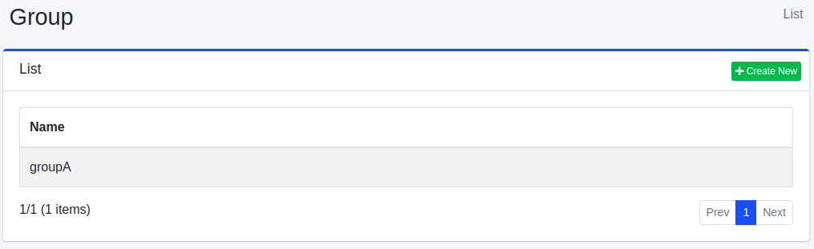

======
그룹
======

개요
====

사용자가 속한 그룹을 관리할 수 있습니다.
LDAP 연계를 하는 경우 등에 사용할 수 있습니다.

관리 방법
======

표시 방법
------

아래 그림의 그룹 설정 목록 페이지를 열려면 왼쪽 메뉴의 [사용자 > 그룹]을 클릭합니다.

|image0|

편집하려면 설정 이름을 클릭합니다.

설정 생성
--------

그룹 설정 페이지를 열려면 신규 생성 버튼을 클릭합니다.

|image1|

설정 항목
------

이름
::::

그룹 이름.

gidNumber
:::::::::

그룹의 gidNumber(LDAP의 POSIX 그룹 ID)를 숫자로 지정합니다. 생략할 수 있습니다. 숫자가 아닌 값을 입력하면 오류가 발생합니다.
|Fess| 가 관리 화면에서 LDAP를 관리하도록 설정된 경우(``ldap.admin.enabled=true``), LDAP의 그룹 엔트리의 ``gidNumber`` 속성(속성 이름은 ``ldap.attr.gidNumber`` 로 변경할 수 있습니다)에 기록됩니다. LDAP를 사용하지 않는 경우에는 지정할 필요가 없습니다.

삭제 방법
--------

목록 페이지의 설정 이름을 클릭하고 삭제 버튼을 클릭하면 확인 화면이 표시됩니다.
삭제 버튼을 누르면 설정이 삭제됩니다.

.. |image1| image:: ../../../resources/images/en/15.10/admin/group-2.png
