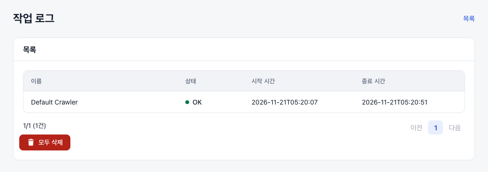

========
작업 로그
========

개요
====

실행한 작업의 결과를 목록으로 표시합니다.

관리 방법
======

표시 방법
------

아래 그림의 작업 로그 확인 페이지를 열려면 왼쪽 메뉴의 [시스템 정보 > 작업 로그]를 클릭합니다.

|image0|

목록 아래의 모두 삭제 버튼을 클릭하면 모든 작업 로그가 삭제됩니다. 확인 대화상자가 표시됩니다.

작업 로그 세부 정보
-----------

작업의 로그 내용을 확인할 수 있습니다. 작업 이름, 상태, 시작·완료 시각, 결과 등을 표시합니다.

|image1|

이름
::::

실행된 작업 이름.

상태
::::

작업의 실행 결과.

.. note::
   크롤링 작업의 상태가 OK(``ok``)라도 모든 문서가 색인에 등록되었다고는 할 수 없습니다. 상태가 나타내는 것은 크롤러 프로세스가 정상적으로 종료되었는지 여부입니다. 검색 엔진이 색인에 대한 쓰기를 거부한 문서는 등록되지 않지만, 작업은 OK로 끝날 수 있습니다. 거부된 문서는 ``fess-crawler.log`` 에 ``Failed to index a document`` 등의 경고로 출력됩니다. 웹과 파일 크롤링에서는 장애 URL에 기록되지 않습니다. 색인의 문서 수도 함께 확인하십시오( :doc:`../config/admin-logging` 의 "색인의 문서 수와 크롤링의 최신성" 참조).

대상
::::

작업이 실행되는 대상.

시작 시간
::::::

작업이 시작한 일시.

종료 시간
::::::

작업이 종료한 일시.

실행 방법
::::::

작업이 실행된 실행 환경.

스크립트
::::::::

작업의 실행 내용.

결과
::::

작업의 실행 결과.

세부 정보 페이지의 삭제 버튼을 클릭하면 작업 로그가 삭제됩니다. 확인 대화상자가 표시됩니다.

.. |image1| image:: ../../../resources/images/ko/15.10/admin/joblog-2.png
