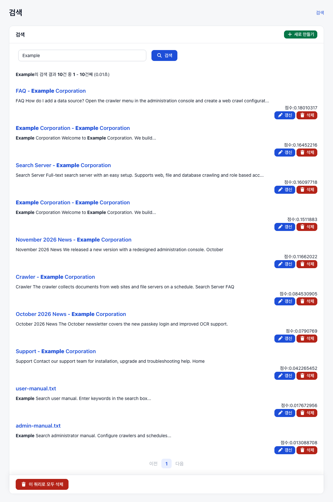
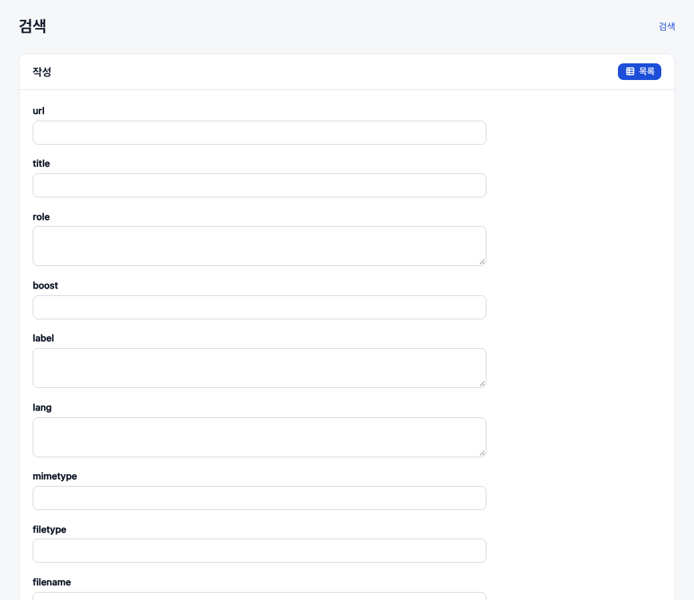

====
검색
====

개요
====

여기서는 관리용 검색에 대해 설명합니다.

관리 방법
======

표시 방법
------

아래 그림의 검색 페이지를 열려면 왼쪽 메뉴의 [시스템 정보 > 검색]을 클릭합니다.

검색 폼에 키워드를 입력하고 검색 버튼을 클릭합니다. 검색 결과가 아래와 같이 표시됩니다.

|image0|

검색 목록
------

지정한 조건으로 검색할 수 있습니다.
일반 검색 화면에서는 역할이나 브라우저의 조건이 암묵적으로 추가되지만, 이 관리용 검색에서는 추가되지 않습니다.
표시된 검색 결과에서 특정 문서를 인덱스에서 삭제할 수도 있습니다.
검색 결과의 문서를 편집하려면 해당 문서의 갱신 버튼을 클릭합니다.
문서를 인덱스에서 삭제하려면 해당 문서의 삭제 버튼을 클릭한 다음 확인 대화상자의 삭제 버튼을 클릭합니다.

일괄 삭제
------

인덱스에서 모든 문서를 삭제하려면 "\*:\*"로 "이 쿼리로 모두 삭제" 버튼을 클릭하여 삭제됩니다.
검색 조건을 지정하여 대상 문서만 삭제하는 것도 가능합니다.
페이지 하단의 "이 쿼리로 모두 삭제" 버튼을 클릭하면 확인 대화상자가 표시되며, 쿼리와 일치하는 모든 문서가 인덱스에서 삭제됩니다.

문서 생성
---------

페이지 오른쪽 위의 새로 만들기 버튼을 클릭하면 인덱스에 문서를 추가하는 폼이 표시됩니다.

|image1|

폼에는 문서의 필드가 ``url`` , ``title`` , ``role`` 과 같은 필드 이름으로 나열됩니다. ``url`` 과 ``title`` 은 필수입니다.

- ``role`` , ``label`` , ``lang`` , ``virtual_host`` 처럼 여러 값을 가질 수 있는 필드는 텍스트 영역이며, 한 줄에 하나씩 값을 입력합니다.
- ``boost`` 는 숫자이고, ``content_length`` , ``favorite_count`` , ``click_count`` 는 정수입니다.
- 날짜 필드(``created`` , ``timestamp`` , ``last_modified`` , ``expires`` )는 ``2026-01-01T00:00:00.000Z`` 와 같이 ``yyyy-MM-ddTHH:mm:ss.SSSZ`` 형식으로 입력합니다.

이 값들의 형식은 폼을 전송할 때 브라우저가 확인합니다. 작성 버튼을 클릭하면 문서가 추가됩니다.
문서를 갱신하는 폼에도 같은 필드가 있습니다.

