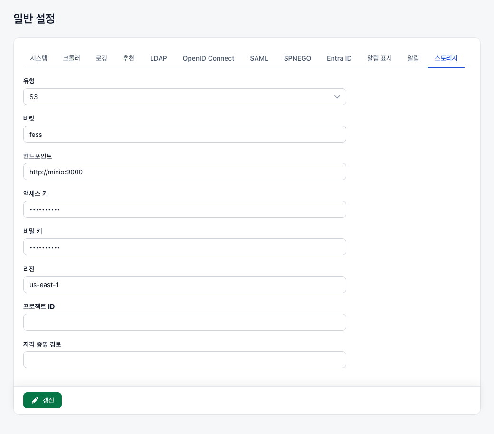
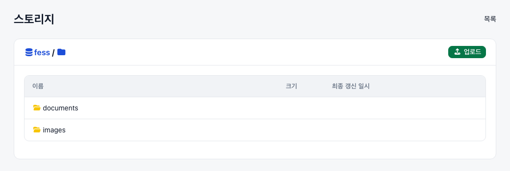

========
스토리지
========

개요
====

스토리지 페이지에서는 Amazon S3 호환 객체 스토리지인 MinIO의 파일을 관리할 수 있습니다.

관리 방법
======

객체 스토리지 서버 설정
---------------------------

[시스템 > 일반]의 [스토리지] 탭을 열고 다음 항목을 설정합니다.
버킷과 엔드포인트가 설정되면(또는 유형이 GCS이면) [시스템 > 스토리지] 메뉴가 표시됩니다.

|image0|

- 엔드포인트: 스토리지 서버의 엔드포인트 URL
- 액세스 키: 스토리지 서버의 액세스 키
- 비밀 키: 스토리지 서버의 비밀 키
- 버킷: 관리할 버킷 이름

.. note::
   Amazon S3 및 S3 호환 스토리지 지원은 ``fess-storage-s3`` 플러그인에서 제공됩니다. 배포물에
   포함되어 있지 않으므로 관리 화면의 「시스템 > 플러그인」 페이지 또는
   ``bin/fess-setup install plugin fess-storage-s3`` 로 설치하십시오.

.. note::
   Google Cloud Storage 지원은 ``fess-storage-gcs`` 플러그인에서 제공됩니다. 배포물에
   포함되어 있지 않으므로 관리 화면의 「시스템 > 플러그인」 페이지 또는
   ``bin/fess-setup install plugin fess-storage-gcs`` 로 설치하십시오.

표시 방법
------

아래 그림의 객체 목록 페이지를 열려면 왼쪽 메뉴의 [시스템 > 스토리지]를 클릭합니다.

|image1|

이름
::::

객체의 파일 이름

크기
:::::

객체의 크기

최종 갱신 일시
:::::::::

객체의 최종 갱신 일시

다운로드
---------

다운로드 버튼을 클릭하여 객체를 다운로드할 수 있습니다.

삭제
----

삭제 버튼을 클릭하여 객체를 삭제할 수 있습니다.

업로드
---------

오른쪽 상단의 업로드 버튼을 클릭하여 파일 업로드 창을 열 수 있습니다.

폴더 생성
------------

경로 표시 오른쪽에 있는 폴더 아이콘을 클릭하여 폴더 생성 창을 열 수 있습니다. 빈 폴더는 생성할 수 없음에 유의하십시오.

