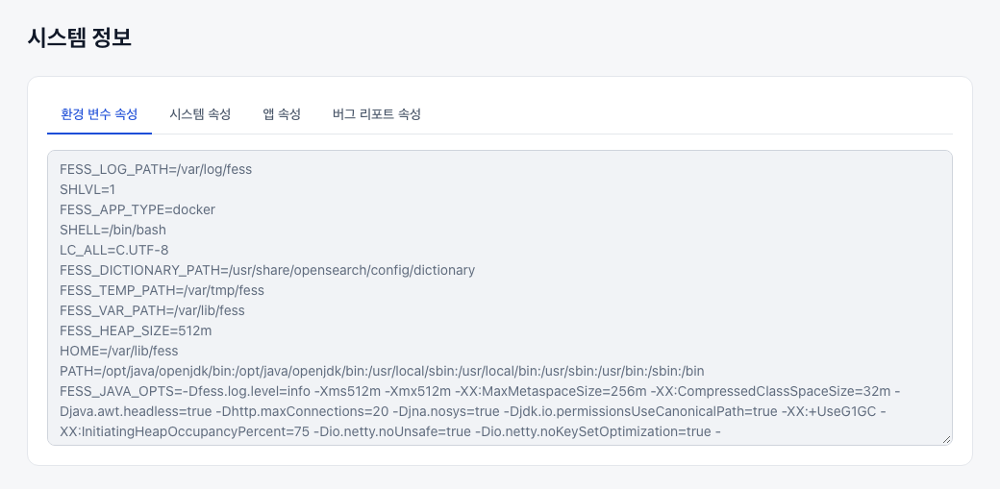
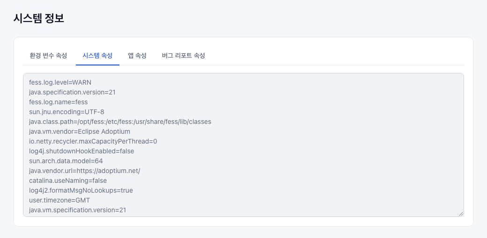
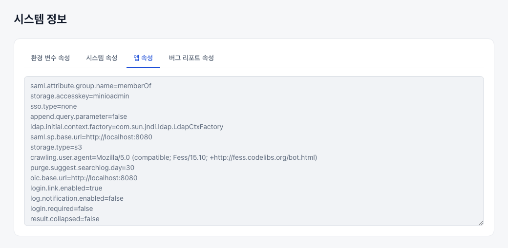
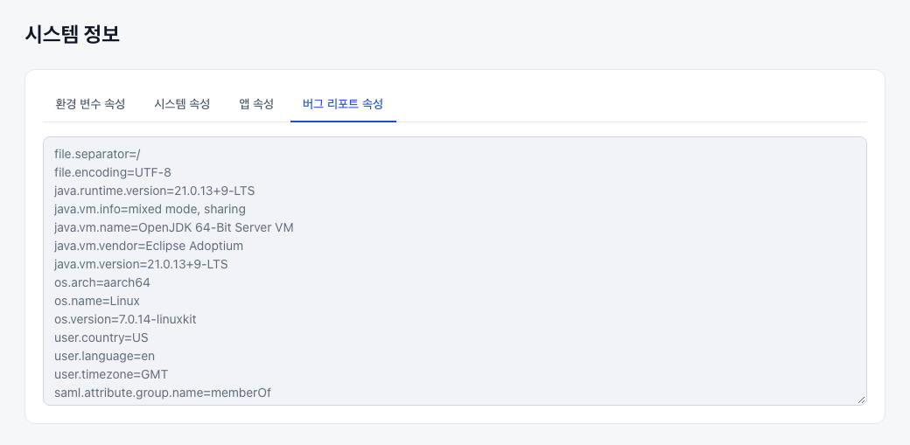

=========
시스템 정보
=========

개요
====

여기서는 현재 가동 중인 시스템에 관한 환경 변수 등의 속성 정보를 확인할 수 있습니다.

관리 방법
======

표시 방법
------

아래 그림의 시스템 정보 페이지를 열려면 왼쪽 메뉴의 [시스템 정보 > 설정 정보]를 클릭합니다.
페이지에는 4개의 탭이 있으며, 아래에서 설명합니다.

표시 항목
------

환경 변수 속성
:::::::::::::::

|image0|

서버의 환경 변수를 목록으로 볼 수 있습니다.

시스템 속성
:::::::::::::::

|image1|

|Fess| 에 설정된 시스템 속성을 목록으로 볼 수 있습니다.

앱 속성
::::::::::::::

|image2|

|Fess| 의 설정 정보를 확인할 수 있습니다.

버그 리포트 속성
::::::::::::::::::

|image3|

버그를 보고할 때 첨부할 속성 목록입니다.
개인 정보가 포함되지 않은 값을 추출합니다.

