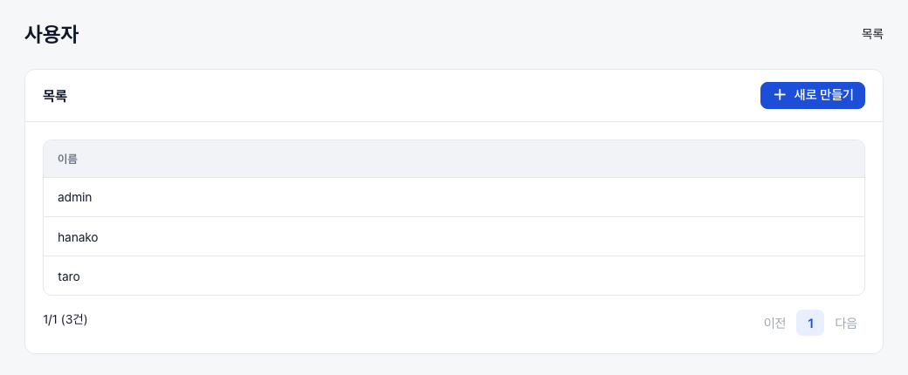
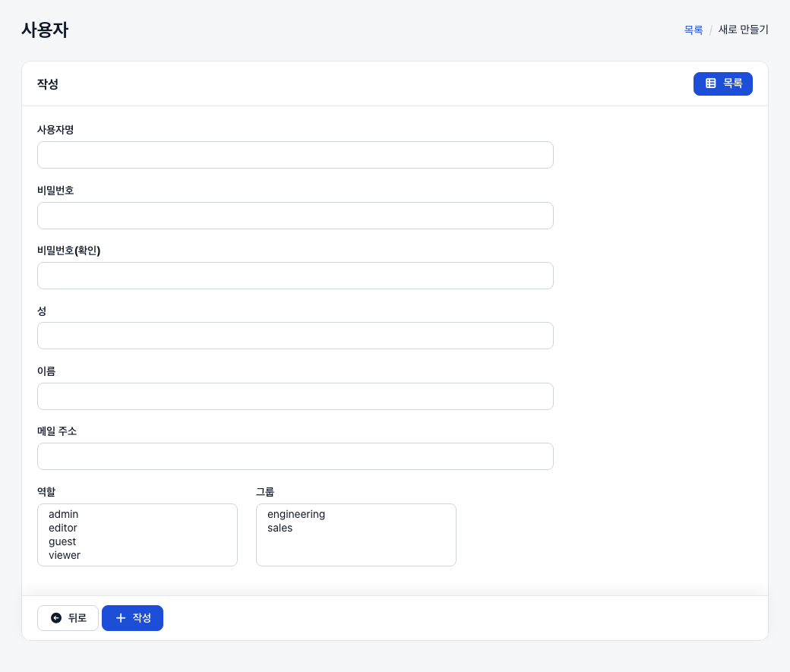

======
사용자
======

개요
====

|Fess| 에 로그인하는 사용자를 관리할 수 있습니다.

관리 방법
======

표시 방법
------

아래 그림의 사용자 설정 목록 페이지를 열려면 왼쪽 메뉴의 [사용자 > 사용자]를 클릭합니다.

|image0|

편집하려면 설정 이름을 클릭합니다.

설정 생성
--------

사용자 설정 페이지를 열려면 신규 생성 버튼을 클릭합니다.

|image1|

설정 항목
------

사용자명
::::::::

사용자명. 사용자를 만든 후에는 변경할 수 없습니다.

비밀번호, 비밀번호(확인)
::::::::::::::::::::::::

사용자의 비밀번호를 지정하고, 비밀번호(확인)에 같은 값을 다시 입력합니다. 사용자를 만들 때는 비밀번호가 필수입니다. 사용자를 편집할 때 두 항목을 모두 비워 두면 현재 비밀번호가 유지됩니다.

성, 이름, 메일 주소
:::::::::::::::::::

사용자의 성, 이름, 메일 주소를 지정합니다. 이 항목들은 선택 사항입니다.

역할
:::::

사용자가 속한 역할을 지정합니다.

.. note::

   ``admin-user`` 역할을 가진 사용자는 관리자 역할을 포함한 기존의 모든 역할을 임의의 사용자에게 부여할 수 있습니다. ``admin-*`` 역할은 관리자 역할과 동등하게 취급하십시오. 자세한 내용은 :doc:`../install/security` 를 참조하십시오.

그룹
::::::

사용자가 속한 그룹을 지정합니다.

설정 삭제
--------

목록 페이지의 설정 이름을 클릭하고 삭제 버튼을 클릭하면 확인 대화상자가 표시됩니다.
대화상자의 삭제 버튼을 누르면 설정이 삭제됩니다.

