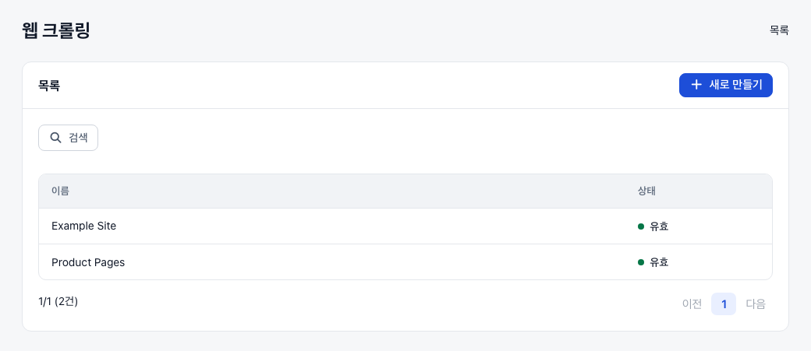
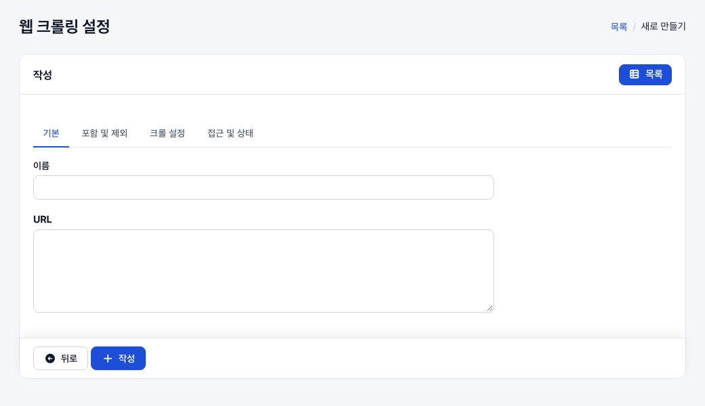
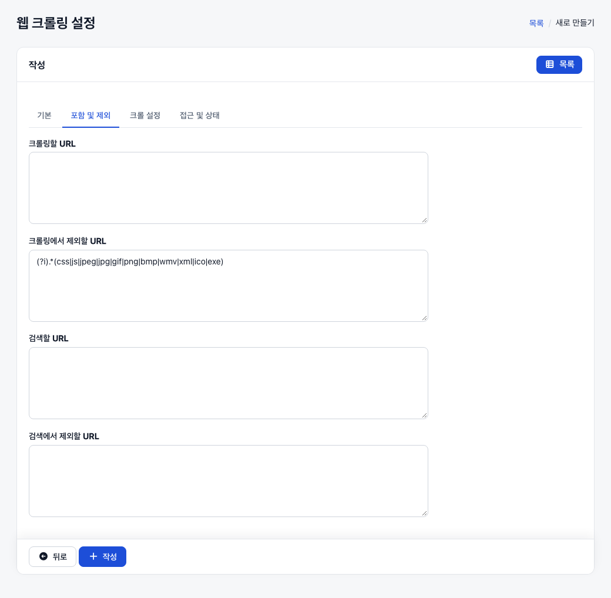
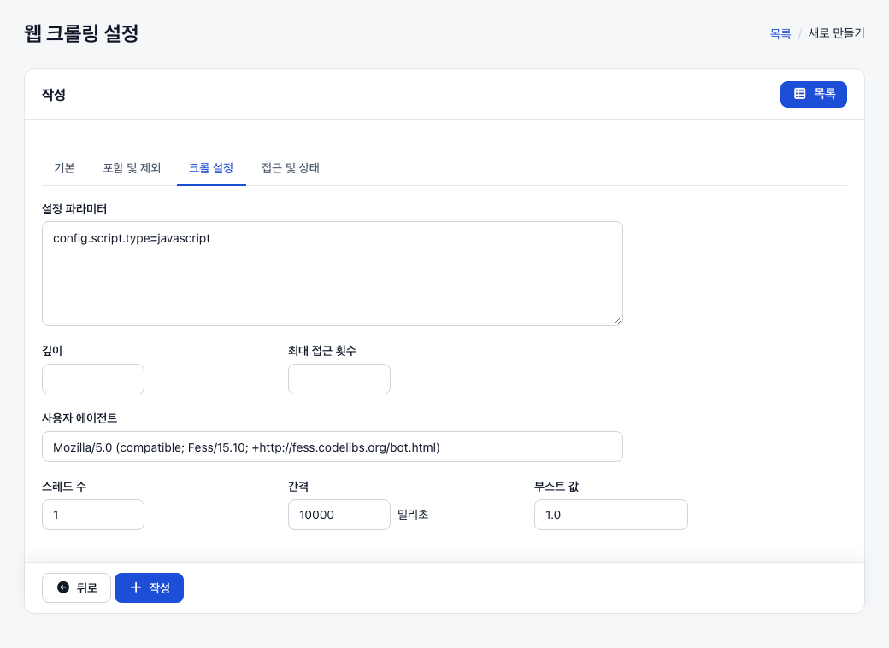
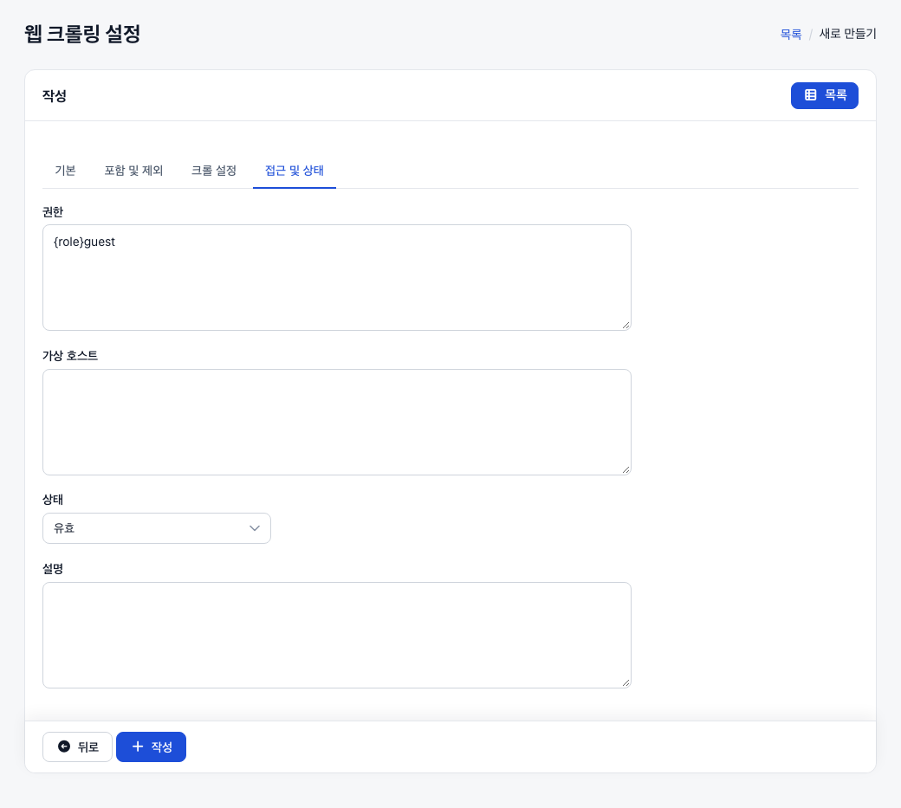

===========================
웹 크롤링(웹사이트 검색)
===========================

개요
====

웹 크롤링은 공개 웹사이트나 인트라넷 내 웹사이트를 웹 크롤러로 순회하며 수집한 페이지를 |Fess| 의 인덱스에 등록하여 전문 검색(웹사이트 검색)할 수 있도록 하는 기능입니다. BASIC・DIGEST・NTLM・폼 인증으로 보호된 사이트의 크롤링도 지원합니다.

웹 크롤링 설정 페이지에서는 웹 크롤링 설정을 수행합니다.

관리 방법
======

표시 방법
------

아래 그림의 웹 크롤링 설정 목록 페이지를 열려면 왼쪽 메뉴의 [크롤러 > 웹]을 클릭합니다.

|image0|

편집하려면 설정 이름을 클릭합니다.

설정 생성
--------

웹 크롤링 설정 페이지를 열려면 생성 버튼을 클릭합니다.
페이지는 "기본", "포함 및 제외", "크롤 설정", "접근 및 상태"의 4개 탭으로 나뉘어 있습니다. 탭 이름을 클릭하면 탭이 전환됩니다. 입력에 오류가 있으면 해당 입력을 포함한 탭이 자동으로 열립니다. 각 탭의 항목은 아래와 같습니다.

기본 탭
-------

|image1|

이름
::::

설정 이름.

URL
::::

크롤링의 시작점이 되는 URL. 한 줄에 하나씩 지정합니다.

포함 및 제외 탭
---------------

|image2|

크롤링 대상 URL
:::::::::::::::::

이 항목에 지정한 정규 표현식(Java 형식)과 일치하는 URL은 |Fess| 크롤러의 대상이 됩니다.

크롤링 대상에서 제외할 URL
:::::::::::::::::::::

이 항목에 지정한 정규 표현식(Java 형식)과 일치하는 URL은 |Fess| 크롤러의 대상이 되지 않습니다.

검색 대상 URL
::::::::::::::

이 항목에 지정한 정규 표현식(Java 형식)과 일치하는 URL은 검색 대상이 됩니다.

검색 대상에서 제외할 URL
::::::::::::::::::

이 항목에 지정한 정규 표현식(Java 형식)과 일치하는 URL은 검색 대상이 되지 않습니다.

크롤 설정 탭
------------

|image3|

설정 파라미터
::::::::::::

크롤링 설정 정보를 지정할 수 있습니다.

깊이
::::

크롤링한 문서에 포함된 링크를 따라갈 때의 깊이를 지정할 수 있습니다.

최대 접근 횟수
:::::::::::

인덱싱되는 URL의 수.

사용자 에이전트
:::::::::::::::

|Fess| 크롤러의 이름.

스레드 수
::::::::

이 설정에서 크롤링할 스레드 수.

간격
::::

URL을 크롤링할 때 각 스레드의 시간 간격(밀리초 단위).

부스트 값
::::::::

이 설정에서 인덱싱된 문서의 가중치.

접근 및 상태 탭
---------------

|image4|

권한
:::::::::::

이 설정의 권한을 지정합니다.
권한 지정 방법은 예를 들어, developer 그룹에 속한 사용자에게 검색 결과를 표시하려면 {group}developer로 지정합니다.
사용자 단위 지정은 {user}사용자명, 역할 단위 지정은 {role}역할명, 그룹 단위 지정은 {group}그룹명으로 지정합니다.

가상 호스트
::::::::

가상 호스트의 호스트명을 한 줄에 하나씩 지정합니다.
자세한 내용은 :doc:`../config/security-virtual-host` 를 참조하십시오.

상태
::::

활성화된 경우 기본 크롤러의 스케줄 작업에 이 설정이 포함됩니다.

설명
::::

설명을 입력할 수 있습니다.

설정 삭제
--------

목록 페이지의 설정 이름을 클릭하고 삭제 버튼을 클릭하면 확인 대화상자가 표시됩니다. 삭제 버튼을 누르면 설정이 삭제됩니다.

.. note::

   설정을 삭제해도 그 설정이 이미 인덱스에 등록한 문서는 삭제되지 않습니다. 문서는 만료될 때까지 검색할 수 있습니다. 문서는 마지막으로 그 문서를 등록·갱신한 크롤링의 시작 시각으로부터 :doc:`general-guide` 의 "이전 문서 삭제"(``day.for.cleanup``, 기본값 ``3``)에 지정한 일수가 지나면 만료되며, 이후 Doc Purger 작업이 인덱스에서 삭제합니다. ``-1`` 인 경우, 만료 시각 없이 등록된 문서는 이 방법으로는 삭제되지 않습니다.

   문서를 즉시 삭제하려면 직접 인덱스에서 삭제하십시오. 검색 화면(:doc:`searchlist-guide`)에서 그 설정의 문서를 검색하고(예: ``url:`` 이나 ``host:`` 로 좁히기), 검색된 문서를 확인한 다음 "이 쿼리로 모두 삭제" 버튼을 클릭합니다. ``DELETE /api/admin/searchlist/query`` 로도 같은 작업을 할 수 있습니다(:doc:`../api/admin/api-admin-searchlist` 참조).

   설정의 접근 권한을 변경하고 다시 크롤링하는 경우는 다릅니다. 문서 ID는 접근 권한에 따라 결정되며, 크롤러는 문서를 등록할 때 같은 설정이 이전에 등록한, URL은 같고 ID가 다른 문서를 삭제합니다.

예
==

fess.codelibs.org 크롤링하기
-----------------------------

https://fess.codelibs.org/ 아래 페이지를 크롤링하는 웹 크롤링 설정을 생성하는 경우 아래와 같은 설정 값을 사용합니다.

.. tabularcolumns:: |p{4cm}|p{8cm}|
.. list-table::
   :header-rows: 1

   * - 설정 항목
     - 설정 값
   * - 이름
     - Fess
   * - URL
     - https://fess.codelibs.org/
   * - 크롤링 대상 URL
     - https://fess.codelibs.org/.\*

다른 설정 값은 기본값을 사용합니다.

웹 인증 사이트의 웹 크롤링
------------------------

Fess는 BASIC 인증, DIGEST 인증, NTLM 인증에 대한 크롤링을 지원합니다.
웹 인증에 대한 자세한 내용은 웹 인증 페이지를 참조하십시오.

Redmine
:::::::

비밀번호로 보호되는 Redmine(예. https://<server>/)의 페이지를 크롤링하는 웹 크롤링 설정을 생성하는 경우 아래와 같은 설정 값을 사용합니다.

.. tabularcolumns:: |p{4cm}|p{8cm}|
.. list-table::
   :header-rows: 1

   * - 설정 항목
     - 설정 값
   * - 이름
     - Redmine
   * - URL
     - https://<server>/my/page
   * - 크롤링 대상 URL
     - https://<server>/.\*
   * - 설정 매개변수
     - client.robotsTxtEnabled=false (선택 사항)

그 후 아래와 같은 설정 값으로 웹 인증 설정을 생성합니다.

.. tabularcolumns:: |p{4cm}|p{8cm}|
.. list-table::
   :header-rows: 1

   * - 설정 항목
     - 설정 값
   * - 스키마
     - Form
   * - 사용자 이름
     - (크롤링용 계정)
   * - 비밀번호
     - (계정의 비밀번호)
   * - 매개변수
     - | encoding=UTF-8
       | token_method=GET
       | token_url=https://<server>/login
       | token_pattern=name="authenticity_token"[^>]+value="([^"]+)"
       | token_name=authenticity_token
       | login_method=POST
       | login_url=https://<server>/login
       | login_parameters=username=${username}&password=${password}
   * - 웹 설정
     - Redmine

XWiki
:::::

XWiki(예. https://<server>/xwiki/)의 페이지를 크롤링하는 웹 크롤링 설정을 생성하는 경우 아래와 같은 설정 값을 사용합니다.

.. tabularcolumns:: |p{4cm}|p{8cm}|
.. list-table::
   :header-rows: 1

   * - 설정 항목
     - 설정 값
   * - 이름
     - XWiki
   * - URL
     - https://<server>/xwiki/bin/view/Main/
   * - 크롤링 대상 URL
     - https://<server>/.\*
   * - 설정 매개변수
     - client.robotsTxtEnabled=false (선택 사항)

그 후 아래와 같은 설정 값으로 웹 인증 설정을 생성합니다.

.. tabularcolumns:: |p{4cm}|p{8cm}|
.. list-table::
   :header-rows: 1

   * - 설정 항목
     - 설정 값
   * - 스키마
     - Form
   * - 사용자 이름
     - (크롤링용 계정)
   * - 비밀번호
     - (계정의 비밀번호)
   * - 매개변수
     - | encoding=UTF-8
       | token_method=GET
       | token_url=http://<server>/xwiki/bin/login/XWiki/XWikiLogin
       | token_pattern=name="form_token" +value="([^"]+)"
       | token_name=form_token
       | login_method=POST
       | login_url=http://<server>/xwiki/bin/loginsubmit/XWiki/XWikiLogin
       | login_parameters=j_username=${username}&j_password=${password}
   * - 웹 설정
     - XWiki

관련 항목
============

- :doc:`../config/crawler-basic`
- :doc:`webauth-guide`
- :doc:`fileconfig-guide`
- :doc:`../config/search-basic`

.. pdf            :height: 940 px
