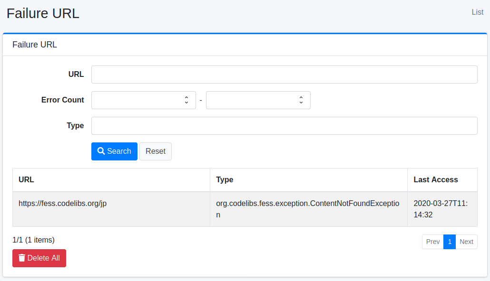
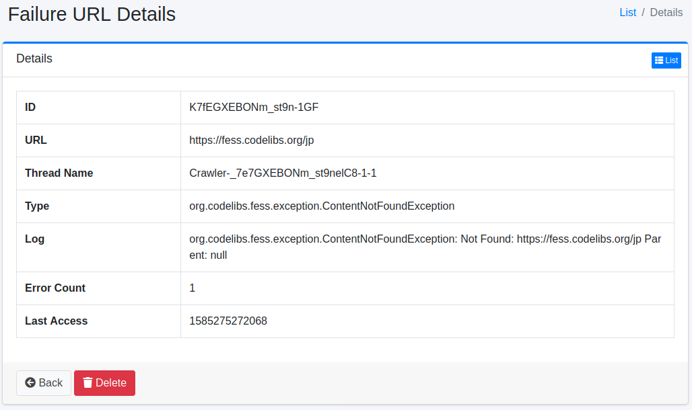

======
失败URL
======

概述
====

本节介绍失败URL。
爬虫时无法获取的URL会被记录，可以作为失败URL查看。

管理方法
======

显示方法
------

要打开用于查看失败URL的列表页面，请点击左侧菜单中的 [系统信息 > 失败URL]。

|image0|

点击失败URL的查看链接将显示详细信息。

列表中的项目
------------

列表显示 URL、类型、MIME 类型、HTTP 状态、大小（字节）和上次访问时间。

MIME 类型、HTTP 状态和大小仅在爬虫已知时记录，未知时为空白。

- 记录的情况：获取文档之后处理失败时（超过大小上限等），以及服务器返回了 ``crawler.failure.url.status.codes`` 中所列的 HTTP 状态时。如果在获取之前因超过大小上限而被拒绝，则只记录大小。
- 不记录的情况：超时、连接错误等未能获得响应时，以及数据存储爬取的失败。文本提取失败（例如无法读取的 PDF）在默认的 ``crawler.ignore.content.exception=true`` 下同样不会记录，该文档会在没有正文的情况下被索引；只有该键为 ``false`` 时才会记录。
- HTTP 状态仅记录 ``http`` / ``https`` 的 URL。文件、SMB 等其他协议为空白。
- |Fess| 15.10 之前记录的失败URL，在该URL再次失败之前，这些项目一直为空白。

CSV下载
-------

通过列表中的 [下载 CSV] 按钮，可以将与搜索表单中输入的条件（URL、错误数和类型）匹配的失败URL以 CSV 文件下载。文件名为 ``failureurl_yyyyMMddHHmmss.csv`` 。

- 第一行是列名，依次为 ``url`` 、 ``errorName`` 、 ``errorCount`` 、 ``lastAccessTime`` 、 ``httpStatusCode`` 、 ``mimeType`` 、 ``contentLength`` 。不包含日志（堆栈跟踪）。
- 输出所有匹配的行，按上次访问时间从新到旧排列。不受分页影响，也没有行数上限。
- ``lastAccessTime`` 为 UTC 的 ISO 8601 格式（例如 ``2026-01-01T00:00:00.000Z`` ）。
- 字符编码遵循 [系统 > 通用] 中的“CSV文件编码”，UTF-8 时会加上 BOM。
- 为避免电子表格将值当作公式执行，以 ``=`` 、 ``+`` 、 ``-`` 、 ``@`` 、制表符或回车符开头的值前会加上 ``'`` 。

失败URL详情
===========

失败URL详情中记录了爬虫时发生的异常。

|image1|

详情内容
--------

URL
::::

发生异常的URL。

线程名称
::::::::

执行爬虫的线程名称。
可在查看日志文件时使用。

类型
::::

异常的类型。

HTTP 状态
:::::::::

获取文档时的 HTTP 状态。仅在 ``http`` / ``https`` 的 URL 且爬虫已知时记录。

MIME 类型
:::::::::

文档的 MIME 类型。仅在爬虫已知时记录。

大小（字节）
::::::::::::

文档的大小。仅在爬虫已知时记录。

日志
::::

异常的内容。

错误数
::::::::

此异常发生的次数。

上次访问时间
::::::::::::

此异常发生的时间。

