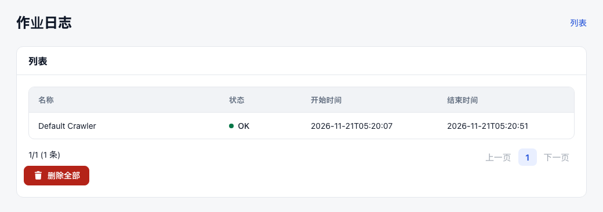
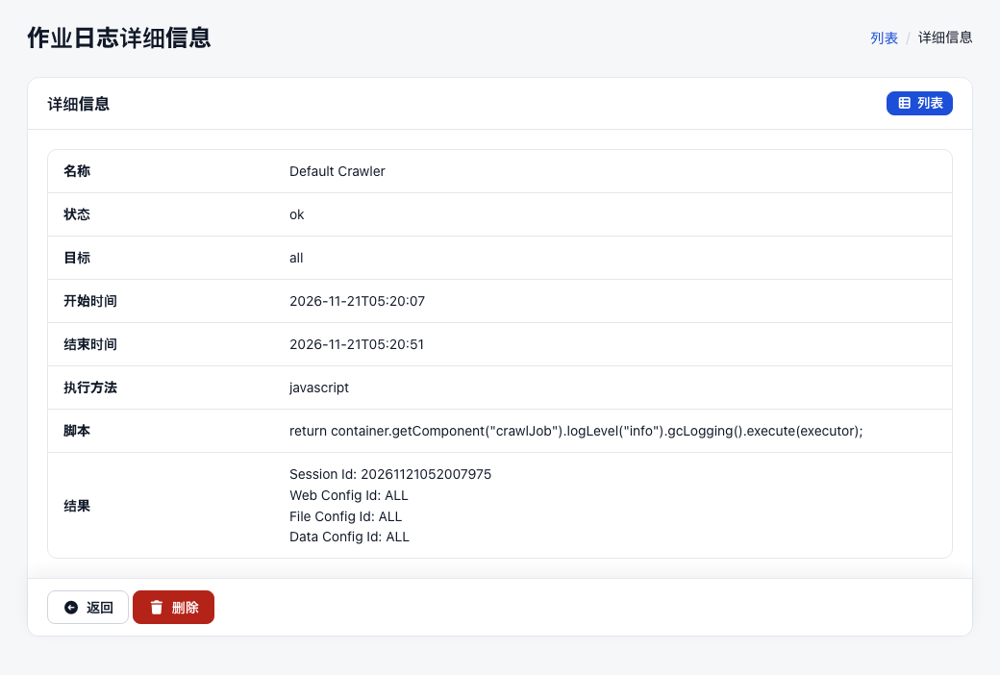

========
作业日志
========

概述
====

以列表形式显示已执行作业的结果。

管理方法
======

显示方法
------

要打开下图所示的作业日志查看页面，请点击左侧菜单中的 [系统信息 > 作业日志]。

|image0|

点击列表下方的删除全部按钮可删除所有作业日志，此时会显示确认对话框。

作业日志详情
-----------

可以查看作业的日志内容。显示作业名称、状态、开始和完成时间、结果等信息。

|image1|

名称
::::

已执行的作业名称。

状态
::::

作业的执行结果。

.. note::
   即使爬取作业的状态为 OK（``ok``），也不一定所有文档都已登记到索引中。状态表示的是爬虫进程是否正常结束。搜索引擎拒绝写入索引的文档不会被登记，但作业仍会以 OK 结束。被拒绝的文档会以 ``Failed to index a document`` 警告的形式输出到 ``fess-crawler.log``。在 Web 和文件爬取中，它不会被记录为失败URL。请同时确认索引的文档数（请参阅 :doc:`../config/admin-logging` 中的“索引的文档数与爬取的时效性”）。

目标
::::

作业执行的目标。

开始时间
::::::

作业开始的日期和时间。

结束时间
::::::

作业结束的日期和时间。

执行方法
::::::

作业执行的运行环境。

脚本
::::::::

作业的执行内容。

结果
::::

作业的执行结果。

点击详细页面中的删除按钮可删除该作业日志，此时会显示确认对话框。

