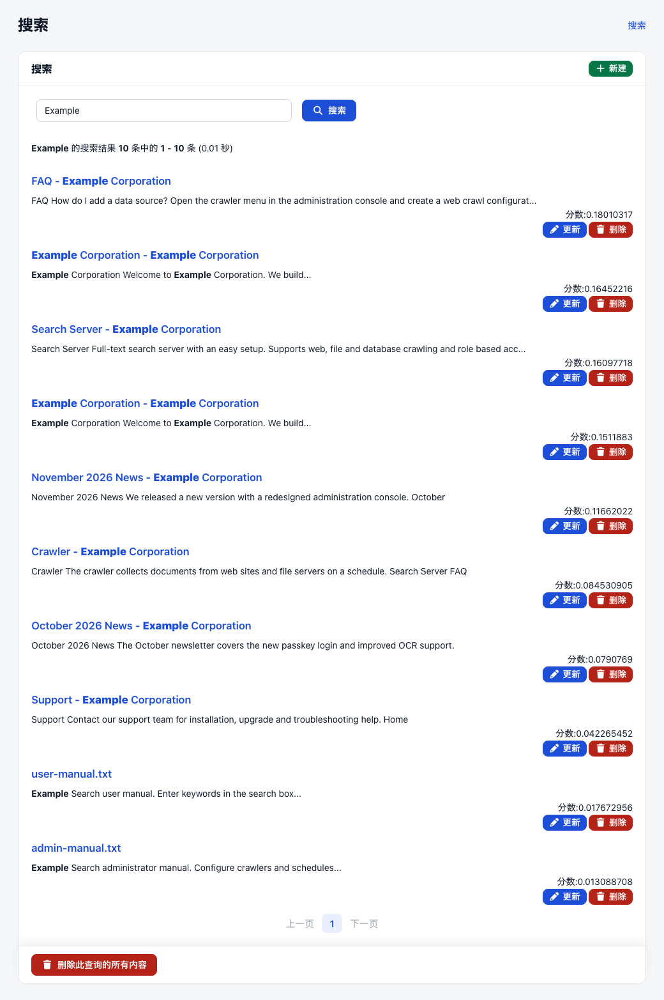
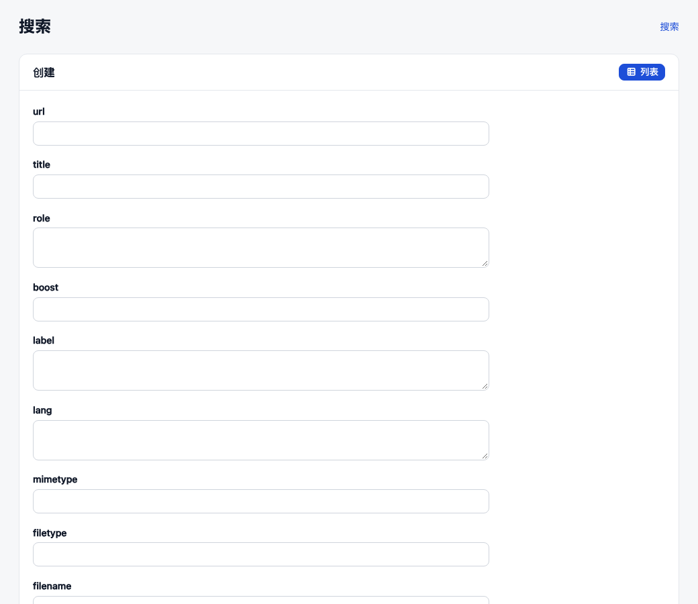

====
搜索
====

概述
====

本节介绍管理搜索功能。

管理方法
======

显示方法
------

要打开搜索页面，请点击左侧菜单中的 [系统信息 > 搜索]，将显示搜索表单。

在搜索表单中输入关键词并点击搜索按钮，搜索结果将如下图所示显示。

|image0|

搜索列表
------

可以按指定条件进行搜索。
普通搜索界面会隐式添加角色和浏览器条件，但此管理搜索不会添加这些条件。
要编辑搜索结果中的文档，请点击该文档的更新按钮。
要从索引中删除特定文档，请点击该文档的删除按钮，然后点击确认对话框中的删除按钮。

批量删除
------

如果要从索引中删除所有文档，请使用"\*:\*"并点击"删除此查询的所有内容"按钮即可删除。
也可以指定搜索条件仅删除目标文档。此时会显示确认对话框。

创建文档
--------

点击页面右上角的新建按钮，将显示用于向索引添加文档的表单。

|image1|

表单按字段名称（如 ``url`` 、 ``title`` 、 ``role`` ）列出文档的字段。 ``url`` 和 ``title`` 为必填项。

- ``role`` 、 ``label`` 、 ``lang`` 、 ``virtual_host`` 等可以包含多个值的字段为文本区域，每行输入一个值。
- ``boost`` 为数值， ``content_length`` 、 ``favorite_count`` 、 ``click_count`` 为整数。
- 日期字段（ ``created`` 、 ``timestamp`` 、 ``last_modified`` 、 ``expires`` ）以 ``yyyy-MM-ddTHH:mm:ss.SSSZ`` 的格式输入，例如 ``2026-01-01T00:00:00.000Z`` 。

这些值的格式会在提交表单时由浏览器检查。点击创建按钮即可添加文档。
更新文档的表单具有相同的字段。

