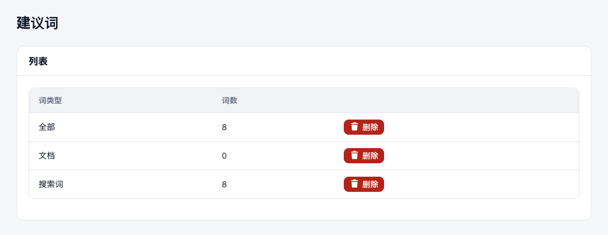

============
建议词
============

概述
====

建议词页面用于管理关键词建议中显示的词汇。

管理方法
======

显示方法
------

要打开下图所示的建议词列表页面，请点击左侧菜单中的 [建议 > 建议词]。

|image0|

如需删除词汇，请点击对应词汇类型的删除按钮，此时会显示确认对话框。

词汇类型
::::::

- 全部：所有已注册的词汇
- 文档：从已索引的文档生成的词汇
- 搜索词：从搜索日志生成的词汇

词数
::::

已注册的词汇数量

