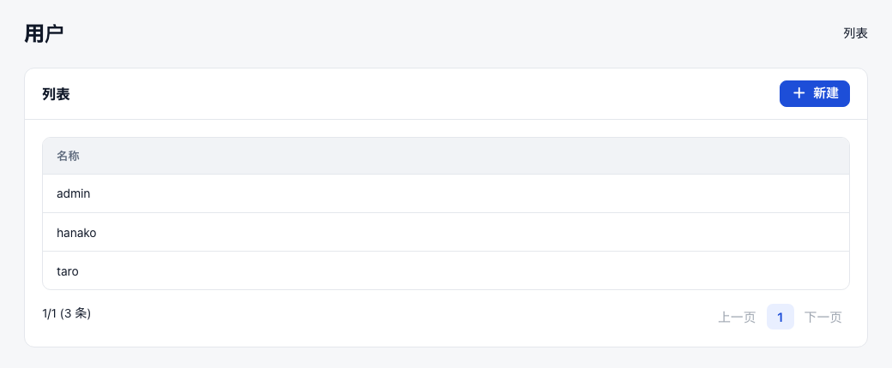
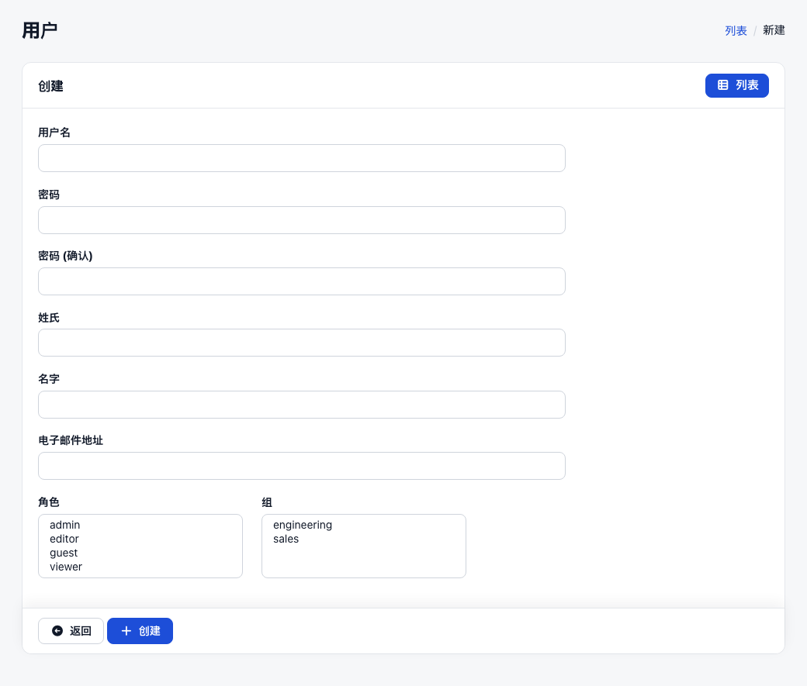

======
用户
======

概述
====

可以管理登录到 |Fess| 的用户。

管理方法
======

显示方法
------

要打开下图所示的用户设置列表页面，请点击左侧菜单中的 [用户 > 用户]。

|image0|

点击设置名称可进行编辑。

创建设置
--------

要打开用户设置页面，请点击新建按钮。

|image1|

配置项
------

用户名
::::::::

用户名。创建用户后无法更改。

密码、密码 (确认)
:::::::::::::::::

指定用户的密码，并在“密码 (确认)”中再次输入。创建用户时必须输入密码。编辑用户时，将这两项留空即可保留当前密码。

姓氏、名字、电子邮件地址
::::::::::::::::::::::::

指定用户的姓氏、名字和电子邮件地址。这些项目为可选项。

角色
:::::

指定用户所属的角色。

.. note::

   拥有 ``admin-user`` 角色的用户可以将包括管理员角色在内的任意现有角色授予任意用户。请将 ``admin-*`` 角色视同管理员角色。详情请参见 :doc:`../install/security`。

组
::::::

指定用户所属的组。

.. note::

   更改用户的密码、角色或组后，该用户的登录会话最迟将在约 60 秒（``password.changed.check.interval`` 的默认值）内结束，用户需要重新登录。更改密码时，执行更改操作的会话会保留；更改角色或组时，执行更改操作的会话同样会结束。详情请参见 :doc:`../install/security`。

删除设置
--------

点击列表页面的设置名称，然后点击删除按钮，将显示确认对话框。
点击对话框中的删除按钮将删除该设置。

