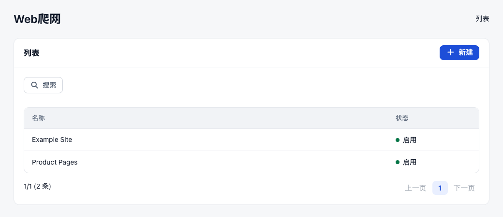
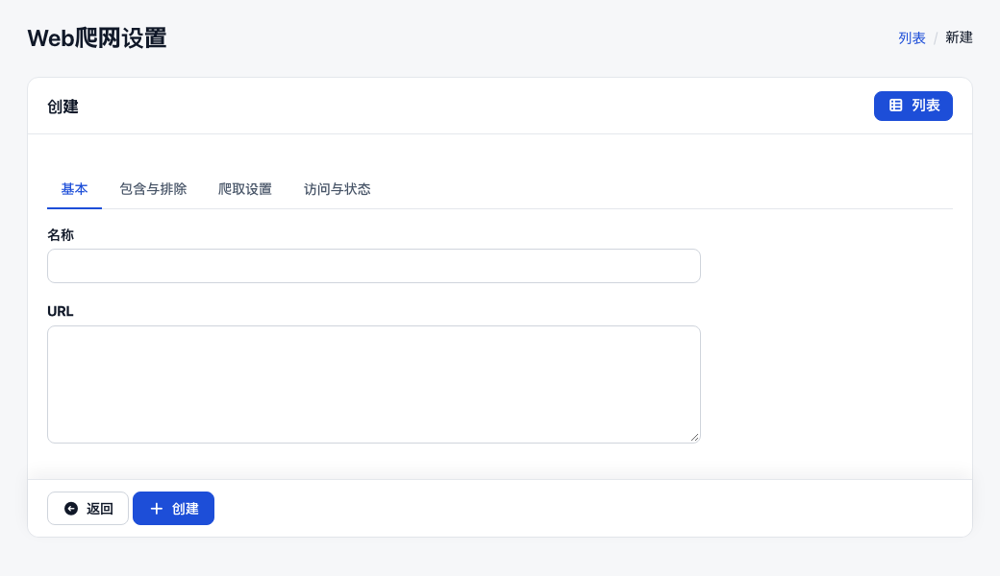
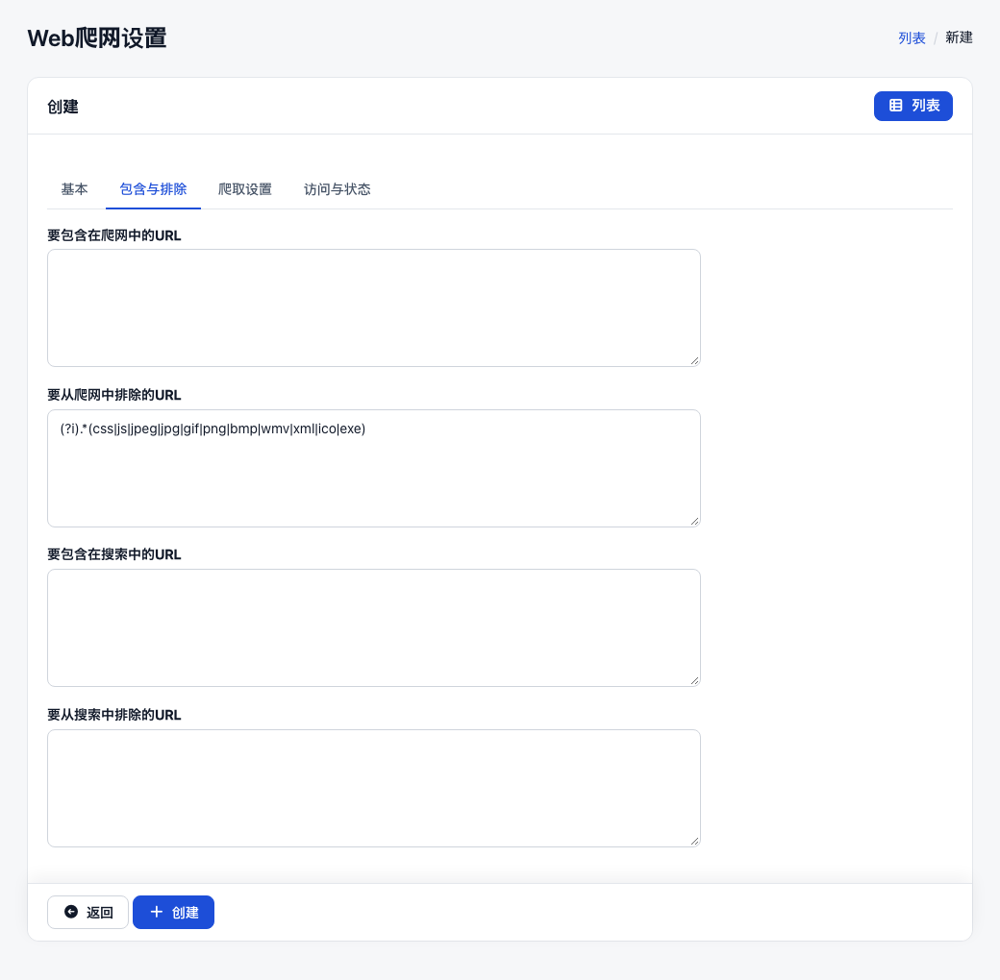
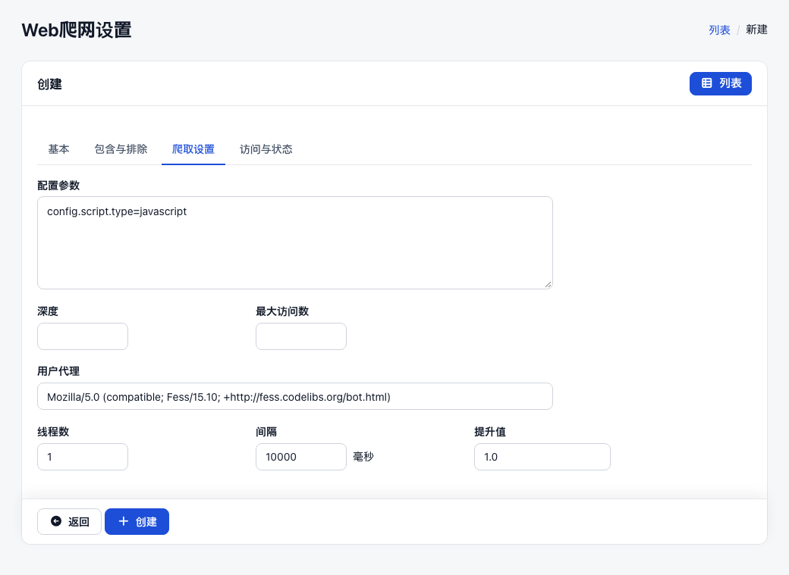
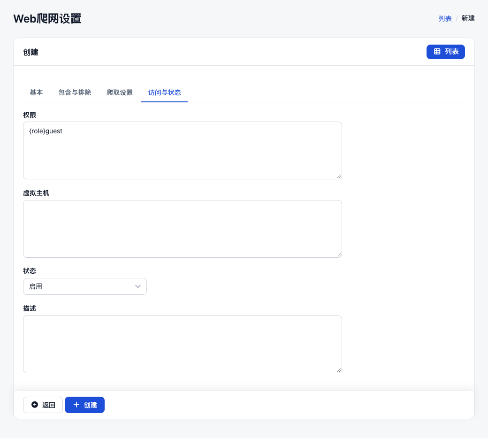

=============================
网页爬取（网站搜索）
=============================

概述
====

网页爬取通过 Web 爬虫巡回公开网站或企业内网中的网站,将采集到的页面注册到 |Fess| 索引,实现全文搜索(网站搜索)的功能。同时支持对 BASIC、DIGEST、NTLM、表单认证保护的网站进行爬取。

网页爬取配置页面用于配置网页爬取的相关设置。

管理方法
======

显示方法
------

要打开下图所示的网页爬取配置列表页面,请点击左侧菜单中的[爬虫 > Web]。

|image0|

点击配置名称即可进行编辑。

创建配置
--------

点击创建按钮可打开网页爬取配置页面。
页面分为四个选项卡:"基本"、"包含与排除"、"爬取设置"和"访问与状态"。单击选项卡名称即可切换。如果某项输入有错误,包含该项的选项卡会自动打开。各选项卡的项目说明如下。

基本选项卡
----------

|image1|

名称
::::

配置名称。

URL
::::

爬取的起始URL。每行指定一个URL。

包含与排除选项卡
----------------

|image2|

爬取对象URL
:::::::::::::::::

与此项中指定的正则表达式(Java格式)匹配的URL将成为 |Fess| 爬虫的爬取对象。

从爬取对象中排除的URL
:::::::::::::::::::::

与此项中指定的正则表达式(Java格式)匹配的URL将从 |Fess| 爬虫的爬取对象中排除。

搜索对象URL
::::::::::::::

与此项中指定的正则表达式(Java格式)匹配的URL将成为搜索对象。

从搜索对象中排除的URL
::::::::::::::::::

与此项中指定的正则表达式(Java格式)匹配的URL将从搜索对象中排除。

.. note::
   此设置仅对之后的爬取中索引的文档生效（匹配的文档不会被索引）。已经在索引中的文档，即使添加了此设置也不会被删除，仍会出现在搜索结果中。在通用设置的“检查上次修改时间”启用（默认）的情况下，未更新的文档在每次爬取时有效期都会被延长（请参阅 :doc:`general-guide` 中的“检查上次修改时间”），因此即使“删除以前的文档”所指定的期限已到，这些文档也不一定会消失。若要确保从搜索结果中消失，请在搜索列表（管理页面）中删除这些文档。已删除的文档只要仍匹配此设置，就不会在下次爬取时被重新索引。

爬取设置选项卡
--------------

|image3|

配置参数
::::::::::::

可以指定爬取配置信息。

深度
::::

可以指定爬取文档中包含的链接时的跟踪深度。

最大访问数
:::::::::::

被索引的URL数量。

用户代理
:::::::::::::::

|Fess| 爬虫的名称。

线程数
::::::::

此配置中用于爬取的线程数。

间隔
::::

爬取URL时每个线程的时间间隔(毫秒)。

提升值
::::::

此配置中被索引文档的权重。

访问与状态选项卡
----------------

|image4|

权限
:::::::::::

指定此配置的权限。
权限的指定方法为,例如,要让属于developer组的用户显示搜索结果,需指定{group}developer。
按用户指定为{user}用户名,按角色指定为{role}角色名,按组指定为{group}组名。

虚拟主机
::::::::

指定虚拟主机的主机名,每行一个。
详情请参阅 :doc:`../config/security-virtual-host`。

状态
::::

如果启用,则默认爬虫的计划任务将包含此配置。

说明
::::

可以输入说明。

删除配置
--------

在列表页面点击配置名称,然后点击删除按钮将显示确认对话框。点击删除按钮后配置将被删除。

.. note::

   删除配置时，该配置已注册到索引中的文档不会被删除。这些文档在过期之前仍可被搜索。文档从最后一次注册或更新它的爬取开始时刻起，经过 :doc:`general-guide` 中“删除以前的文档”（ ``day.for.cleanup``，默认为 ``3``）所指定的天数后过期，随后由Doc Purger作业从索引中删除。指定 ``-1`` 时，注册时未设置过期时间的文档不会通过这种方式被删除。

   要立即删除这些文档，请自行从索引中删除。在搜索界面（ :doc:`searchlist-guide`）中搜索该配置的文档（例如用 ``url:`` 或 ``host:`` 缩小范围），确认命中的文档后，点击“删除此查询的所有内容”按钮。也可以使用 ``DELETE /api/admin/searchlist/query`` 完成同样的操作（请参阅 :doc:`../api/admin/api-admin-searchlist`）。

   更改配置的权限并重新爬取的情况则不同：文档ID取决于权限，爬虫在注册文档时，会删除同一配置之前注册的、URL相同但ID不同的文档。

示例
==

爬取 fess.codelibs.org
-----------------------------

要创建爬取 https://fess.codelibs.org/ 下页面的网页爬取配置,请使用如下配置值。

.. tabularcolumns:: |p{4cm}|p{8cm}|
.. list-table::
   :header-rows: 1

   * - 配置项
     - 配置值
   * - 名称
     - Fess
   * - URL
     - https://fess.codelibs.org/
   * - 爬取对象URL
     - https://fess.codelibs.org/.\*

其他配置值使用默认值。

爬取需要网页认证的站点
------------------------

Fess 支持对 BASIC 认证、DIGEST 认证和 NTLM 认证的站点进行爬取。
有关网页认证的详细信息,请参阅网页认证页面。

Redmine
:::::::

要创建爬取受密码保护的Redmine(例如 https://<server>/)页面的网页爬取配置,请使用如下配置值。

.. tabularcolumns:: |p{4cm}|p{8cm}|
.. list-table::
   :header-rows: 1

   * - 配置项
     - 配置值
   * - 名称
     - Redmine
   * - URL
     - https://<server>/my/page
   * - 爬取对象URL
     - https://<server>/.\*
   * - 配置参数
     - client.robotsTxtEnabled=false (可选)

之后,使用如下配置值创建网页认证配置。

.. tabularcolumns:: |p{4cm}|p{8cm}|
.. list-table::
   :header-rows: 1

   * - 配置项
     - 配置值
   * - 方案
     - Form
   * - 用户名
     - (Account for crawling)
   * - 密码
     - (Password for the account)
   * - 参数
     - | encoding=UTF-8
       | token_method=GET
       | token_url=https://<server>/login
       | token_pattern=name="authenticity_token"[^>]+value="([^"]+)"
       | token_name=authenticity_token
       | login_method=POST
       | login_url=https://<server>/login
       | login_parameters=username=${username}&password=${password}
   * - Web配置
     - Redmine

XWiki
:::::

要创建爬取XWiki(例如 https://<server>/xwiki/)页面的网页爬取配置,请使用如下配置值。

.. tabularcolumns:: |p{4cm}|p{8cm}|
.. list-table::
   :header-rows: 1

   * - 配置项
     - 配置值
   * - 名称
     - XWiki
   * - URL
     - https://<server>/xwiki/bin/view/Main/
   * - 爬取对象URL
     - https://<server>/.\*
   * - 配置参数
     - client.robotsTxtEnabled=false (可选)

之后,使用如下配置值创建网页认证配置。

.. tabularcolumns:: |p{4cm}|p{8cm}|
.. list-table::
   :header-rows: 1

   * - 配置项
     - 配置值
   * - 方案
     - Form
   * - 用户名
     - (Account for crawling)
   * - 密码
     - (Password for the account)
   * - 参数
     - | encoding=UTF-8
       | token_method=GET
       | token_url=http://<server>/xwiki/bin/login/XWiki/XWikiLogin
       | token_pattern=name="form_token" +value="([^"]+)"
       | token_name=form_token
       | login_method=POST
       | login_url=http://<server>/xwiki/bin/loginsubmit/XWiki/XWikiLogin
       | login_parameters=j_username=${username}&j_password=${password}
   * - Web配置
     - XWiki

相关页面
========

- :doc:`../config/crawler-basic`
- :doc:`webauth-guide`
- :doc:`fileconfig-guide`
- :doc:`../config/search-basic`

.. pdf            :height: 940 px
