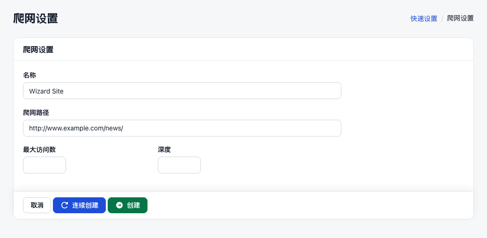
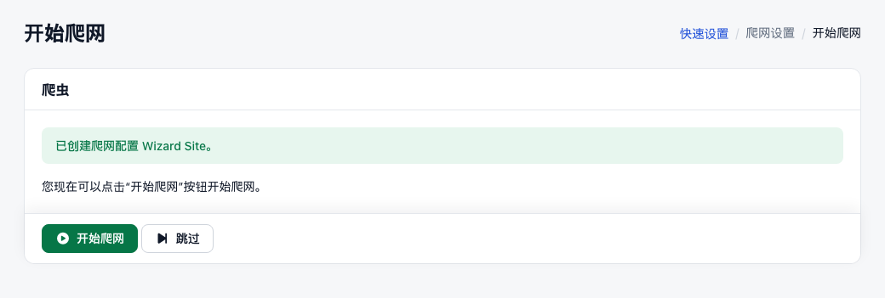

===========
配置向导
===========

概述
====

向导页面提供了一个简易设置工具,用于注册爬取配置。

快速设置
--------

此页面是用于注册爬取配置的启动页面。单击"开始设置"按钮将打开爬取配置页面。

|image0|

爬网设置
--------

在此页面可以创建爬取配置。

|image1|

配置项
------

名称
::::

指定配置名称(例如:Fess网站)。

爬网路径
::::::::

指定爬取起始 URL 或文件路径(例如:https://fess.codelibs.org/)。

最大访问数
:::::::::::

设置要爬取的页面上限。

深度
::::

设置爬取文档中包含的链接时的跟踪深度。

按钮
::::

- **创建**: 注册爬取配置并进入开始爬取页面。
- **连续创建**: 注册爬取配置并返回此表单,以便继续注册其他配置。
- **取消**: 不注册并返回快速设置页面。

爬虫
------

要启动 |Fess| 爬虫,请单击"开始爬取"按钮。如果暂不爬取,请单击"跳过"按钮。

|image2|

